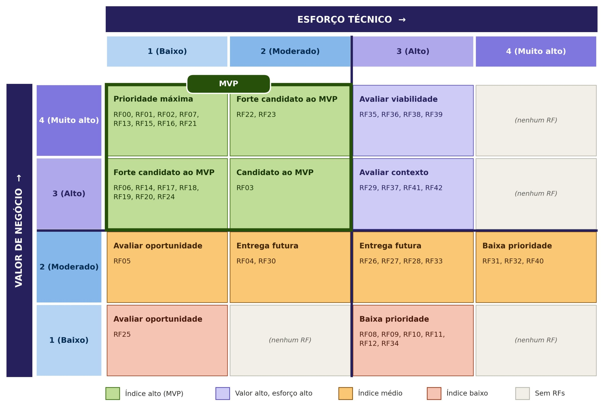

# 10 Escopo de Produto

## 10.1 Escopo Geral

O escopo geral tem 43 códigos de requisito funcional; RF36, RF37 e RF40 foram incorporados ao RF35 e não são reutilizados. A especificação de cada requisito, com declaração, regras de negócio e critérios de aceitação, está **somente na sua ficha** (o código leva a ela). Este backlog não repete critérios, para que não exista uma segunda especificação.

| Código | Requisito | Entrega |
| :--- | :--- | :--- |
| [RF00](../visao/escopo/requisitos/RF00.md) | Encerrar sessão | MVP |
| [RF01](../visao/escopo/requisitos/RF01.md) | Autenticar usuário | MVP |
| [RF02](../visao/escopo/requisitos/RF02.md) | Controlar acesso | MVP |
| [RF03](../visao/escopo/requisitos/RF03.md) | Cadastrar turma | MVP |
| [RF04](../visao/escopo/requisitos/RF04.md) | Editar turma | Pós-MVP |
| [RF05](../visao/escopo/requisitos/RF05.md) | Inativar turma | Pós-MVP |
| [RF06](../visao/escopo/requisitos/RF06.md) | Associar aluno à turma | MVP |
| [RF07](../visao/escopo/requisitos/RF07.md) | Consultar alunos de uma turma | MVP |
| [RF08](../visao/escopo/requisitos/RF08.md) | Registrar doação recebida | Pós-MVP |
| [RF09](../visao/escopo/requisitos/RF09.md) | Editar doação recebida | Pós-MVP |
| [RF10](../visao/escopo/requisitos/RF10.md) | Registrar documentos de prestação de contas | Pós-MVP |
| [RF11](../visao/escopo/requisitos/RF11.md) | Editar documentos de prestação de contas | Pós-MVP |
| [RF12](../visao/escopo/requisitos/RF12.md) | Consultar doações e prestações de contas | Pós-MVP |
| [RF13](../visao/escopo/requisitos/RF13.md) | Publicar conteúdo institucional | MVP |
| [RF14](../visao/escopo/requisitos/RF14.md) | Editar conteúdo institucional | MVP |
| [RF15](../visao/escopo/requisitos/RF15.md) | Consultar conteúdo institucional | MVP |
| [RF16](../visao/escopo/requisitos/RF16.md) | Remover conteúdo institucional | MVP |
| [RF17](../visao/escopo/requisitos/RF17.md) | Publicar evento | MVP |
| [RF18](../visao/escopo/requisitos/RF18.md) | Editar evento | MVP |
| [RF19](../visao/escopo/requisitos/RF19.md) | Remover evento | MVP |
| [RF20](../visao/escopo/requisitos/RF20.md) | Consultar eventos | MVP |
| [RF21](../visao/escopo/requisitos/RF21.md) | Cadastrar aluno | MVP |
| [RF22](../visao/escopo/requisitos/RF22.md) | Editar aluno | MVP |
| [RF23](../visao/escopo/requisitos/RF23.md) | Consultar ficha do aluno | MVP |
| [RF24](../visao/escopo/requisitos/RF24.md) | Inativar aluno | MVP |
| [RF25](../visao/escopo/requisitos/RF25.md) | Remover dados do aluno | Pós-MVP |
| [RF26](../visao/escopo/requisitos/RF26.md) | Registrar frequência | Pós-MVP |
| [RF27](../visao/escopo/requisitos/RF27.md) | Consultar frequência | Pós-MVP |
| [RF28](../visao/escopo/requisitos/RF28.md) | Emitir alerta de faltas críticas | Pós-MVP |
| [RF29](../visao/escopo/requisitos/RF29.md) | Registrar medida disciplinar | Pós-MVP |
| [RF30](../visao/escopo/requisitos/RF30.md) | Publicar aviso | Pós-MVP |
| [RF31](../visao/escopo/requisitos/RF31.md) | Consultar avisos | Pós-MVP |
| [RF32](../visao/escopo/requisitos/RF32.md) | Editar aviso | Pós-MVP |
| [RF33](../visao/escopo/requisitos/RF33.md) | Remover aviso | Pós-MVP |
| [RF34](../visao/escopo/requisitos/RF34.md) | Consultar histórico de avisos | Pós-MVP |
| [RF35](../visao/escopo/requisitos/RF35.md) | Solicitar matrícula online | Pós-MVP |
| [RF36](../visao/escopo/requisitos/RF36.md) | Preencher dados do aluno | Incorporado ao RF35 |
| [RF37](../visao/escopo/requisitos/RF37.md) | Informar dados do responsável legal | Incorporado ao RF35 |
| [RF38](../visao/escopo/requisitos/RF38.md) | Registrar consentimento de dados pessoais | Pós-MVP |
| [RF39](../visao/escopo/requisitos/RF39.md) | Registrar termo de uso de imagem | Pós-MVP |
| [RF40](../visao/escopo/requisitos/RF40.md) | Informar pessoas autorizadas a retirar o aluno | Incorporado ao RF35 |
| [RF41](../visao/escopo/requisitos/RF41.md) | Emitir comprovante de solicitação | Pós-MVP |
| [RF42](../visao/escopo/requisitos/RF42.md) | Analisar solicitações de matrícula | Pós-MVP |

## 10.2 Priorização do Escopo Geral e MVP

A priorização combinou dois modelos: o MoSCoW (Must, Should, Could e Won't have), usado para o valor de negócio e avaliado com o cliente, e a pontuação de esforço técnico atribuída pela equipe (esforço, complexidade e lacuna de capacidade). Os dois critérios orientam o desenvolvimento de acordo com os objetivos do projeto e formam a matriz 4 × 4 da seção 10.2.2.
 
O MVP é o conjunto mínimo de funcionalidades que permite lançar o produto e colocá-lo em uso pelo cliente, com foco nos requisitos essenciais para validar o valor de negócio. Na matriz final (seção 10.2.2), o MVP reúne os RFs com valor de negócio 3 ou 4 e esforço técnico 1 ou 2: 18 dos 43 requisitos.

### 10.2.1 Critérios de priorização

**Esforço técnico:** avaliado pela equipe em três dimensões, todas orientadas no mesmo sentido (maior nota, maior dificuldade).

| Pontuação | Esforço | Complexidade | Lacuna de capacidade da equipe |
|:---:|---|---|---|
| 1 | Até 2 horas | Solução conhecida, com poucas dependências | A equipe domina plenamente o necessário |
| 2 | Entre 2 e 5 horas | Exige alguma investigação ou integração | Conhecimento suficiente, com pouca aprendizagem adicional |
| 3 | Entre 5 e 8 horas | Várias dependências ou incertezas técnicas | A equipe precisa desenvolver conhecimentos relevantes |
| 4 | Mais de 8 horas | Elevada incerteza, integração crítica ou tecnologia não dominada | A equipe ainda não possui os conhecimentos ou recursos |

**Como calcular:** ET = (Esforço + Complexidade + Lacuna) / 3. Para posicionar o RF na matriz, o ET é arredondado para o inteiro mais próximo.

**Valor de negócio (MoSCoW):** avaliado com o cliente, com a escala abaixo.

| Pontuação | Classificação | Interpretação |
|:---:|---|---|
| 4 | Tem que ter (Must have) | Indispensável para resolver o problema central ou viabilizar o produto |
| 3 | Deveria ter (Should have) | Muito importante, mas o produto pode operar temporariamente sem o requisito |
| 2 | Poderia ter (Could have) | Agrega valor, mas pode ser adiado sem comprometer o objetivo principal |
| 1 | Não precisa ter (Won't have now) | Não é prioritário para a versão atual |

### 10.2.2 Matriz 4 × 4

**Índice de prioridade**

- **Alto (MVP):** valor de negócio 3 ou 4 e esforço técnico 1 ou 2. São 18 dos 43 RFs.
- **Valor alto, esforço alto:** valor 3 ou 4 e esforço 3 ou 4. Ficam fora do MVP e pedem avaliar a viabilidade ou o contexto (RF29, RF35, RF38, RF39, RF41 e RF42; RF36 e RF37 foram incorporados ao RF35).
- **Médio:** valor de negócio 2 (moderado), com qualquer esforço.
- **Baixo:** valor de negócio 1.

A coluna "Prior." ordena os índices: 1 (Alto), 2 (valor alto, esforço alto), 3 (Médio) e 4 (Baixo). Ela define grupos, não a ordem de construção dentro de cada grupo; essa ordem está na seção 10.3.

A partir dessas informações, foi gerada a seguinte tabela:

| Código | Índice | Prior. | MVP |
|---|:---:|:---:|:---:|
| [RF02](../visao/escopo/requisitos/RF02.md) | Alto | 1 | ✔ |
| [RF07](../visao/escopo/requisitos/RF07.md) | Alto | 1 | ✔ |
| [RF15](../visao/escopo/requisitos/RF15.md) | Alto | 1 | ✔ |
| [RF16](../visao/escopo/requisitos/RF16.md) | Alto | 1 | ✔ |
| [RF22](../visao/escopo/requisitos/RF22.md) | Alto | 1 | ✔ |
| [RF00](../visao/escopo/requisitos/RF00.md) | Alto | 1 | ✔ |
| [RF03](../visao/escopo/requisitos/RF03.md) | Alto | 1 | ✔ |
| [RF17](../visao/escopo/requisitos/RF17.md) | Alto | 1 | ✔ |
| [RF18](../visao/escopo/requisitos/RF18.md) | Alto | 1 | ✔ |
| [RF19](../visao/escopo/requisitos/RF19.md) | Alto | 1 | ✔ |
| [RF20](../visao/escopo/requisitos/RF20.md) | Alto | 1 | ✔ |
| [RF23](../visao/escopo/requisitos/RF23.md) | Alto | 1 | ✔ |
| [RF14](../visao/escopo/requisitos/RF14.md) | Alto | 1 | ✔ |
| [RF01](../visao/escopo/requisitos/RF01.md) | Alto | 1 | ✔ |
| [RF21](../visao/escopo/requisitos/RF21.md) | Alto | 1 | ✔ |
| [RF06](../visao/escopo/requisitos/RF06.md) | Alto | 1 | ✔ |
| [RF24](../visao/escopo/requisitos/RF24.md) | Alto | 1 | ✔ |
| [RF13](../visao/escopo/requisitos/RF13.md) | Alto | 1 | ✔ |
| [RF35](../visao/escopo/requisitos/RF35.md) | Valor alto, esforço alto | 2 | — |
| [RF36](../visao/escopo/requisitos/RF36.md) | Valor alto, esforço alto | 2 | — |
| [RF29](../visao/escopo/requisitos/RF29.md) | Valor alto, esforço alto | 2 | — |
| [RF37](../visao/escopo/requisitos/RF37.md) | Valor alto, esforço alto | 2 | — |
| [RF39](../visao/escopo/requisitos/RF39.md) | Valor alto, esforço alto | 2 | — |
| [RF38](../visao/escopo/requisitos/RF38.md) | Valor alto, esforço alto | 2 | — |
| [RF42](../visao/escopo/requisitos/RF42.md) | Valor alto, esforço alto | 2 | — |
| [RF41](../visao/escopo/requisitos/RF41.md) | Valor alto, esforço alto | 2 | — |
| [RF04](../visao/escopo/requisitos/RF04.md) | Médio | 3 | — |
| [RF05](../visao/escopo/requisitos/RF05.md) | Médio | 3 | — |
| [RF27](../visao/escopo/requisitos/RF27.md) | Médio | 3 | — |
| [RF30](../visao/escopo/requisitos/RF30.md) | Médio | 3 | — |
| [RF31](../visao/escopo/requisitos/RF31.md) | Médio | 3 | — |
| [RF32](../visao/escopo/requisitos/RF32.md) | Médio | 3 | — |
| [RF33](../visao/escopo/requisitos/RF33.md) | Médio | 3 | — |
| [RF40](../visao/escopo/requisitos/RF40.md) | Médio | 3 | — |
| [RF26](../visao/escopo/requisitos/RF26.md) | Médio | 3 | — |
| [RF28](../visao/escopo/requisitos/RF28.md) | Médio | 3 | — |
| [RF25](../visao/escopo/requisitos/RF25.md) | Baixo | 4 | — |
| [RF12](../visao/escopo/requisitos/RF12.md) | Baixo | 4 | — |
| [RF34](../visao/escopo/requisitos/RF34.md) | Baixo | 4 | — |
| [RF08](../visao/escopo/requisitos/RF08.md) | Baixo | 4 | — |
| [RF09](../visao/escopo/requisitos/RF09.md) | Baixo | 4 | — |
| [RF11](../visao/escopo/requisitos/RF11.md) | Baixo | 4 | — |
| [RF10](../visao/escopo/requisitos/RF10.md) | Baixo | 4 | — |

As notas do cliente e da equipe, os votos individuais e o cálculo que levaram aos resultados acima estão registrados em [Comprovação de Evidência](priorizacao_geral_e_mvp.md). 

## 10.3 Backlog do MVP: ordem de construção e acompanhamento

A ordem segue as dependências: nenhuma ação da coordenação funciona sem autenticação, e as consultas dependem de existir o que consultar. O estado vem da seção *Andamento* de cada ficha, atualizada em 14/11/2026 com a [reunião de 10/11](organizacao_e_planejamento/atas_reunioes/cliente/ata_reuniao_10_11.md). As issues de construção estão no GitHub, e nenhuma tem responsável atribuído até esta data.

| Ordem | RF | Depende de | Iteração prevista | Issue | Responsável | Estado | Pendência ou bloqueio |
| :---: | :--- | :--- | :---: | :---: | :--- | :--- | :--- |
| 1 | [RF01](../visao/escopo/requisitos/RF01.md) Autenticar usuário | — | 7 | [#48](https://github.com/mdsreq-fga-unb/REQ-2026.2-T01-SigCecp/issues/48) | não atribuído | Aceito pelo cliente em 10/11 | — |
| 2 | [RF02](../visao/escopo/requisitos/RF02.md) Controlar acesso | RF01 | 7 | [#49](https://github.com/mdsreq-fga-unb/REQ-2026.2-T01-SigCecp/issues/49) | não atribuído | Aceito pelo cliente em 10/11 | — |
| 3 | [RF00](../visao/escopo/requisitos/RF00.md) Encerrar sessão | RF01 | 7 | [#47](https://github.com/mdsreq-fga-unb/REQ-2026.2-T01-SigCecp/issues/47) | não atribuído | Aceito pelo cliente em 10/11 | — |
| 4 | [RF13](../visao/escopo/requisitos/RF13.md) Publicar conteúdo institucional | RF02 | 5 e 6 | [#39](https://github.com/mdsreq-fga-unb/REQ-2026.2-T01-SigCecp/issues/39) | não atribuído | Aceito pelo cliente em 10/11 | — |
| 5 | [RF15](../visao/escopo/requisitos/RF15.md) Consultar conteúdo institucional | RF13 | 5 e 6 | [#41](https://github.com/mdsreq-fga-unb/REQ-2026.2-T01-SigCecp/issues/41) | não atribuído | Aceito pelo cliente em 10/11 | — |
| 6 | [RF14](../visao/escopo/requisitos/RF14.md) Editar conteúdo institucional | RF13 | 5 e 6 | [#40](https://github.com/mdsreq-fga-unb/REQ-2026.2-T01-SigCecp/issues/40) | não atribuído | Aceito pelo cliente em 10/11 | — |
| 7 | [RF16](../visao/escopo/requisitos/RF16.md) Remover conteúdo institucional | RF13 | 5 e 6 | [#42](https://github.com/mdsreq-fga-unb/REQ-2026.2-T01-SigCecp/issues/42) | não atribuído | Aceito pelo cliente em 10/11 | — |
| 8 | [RF17](../visao/escopo/requisitos/RF17.md) Publicar evento | RF02 | 5 e 6 | [#43](https://github.com/mdsreq-fga-unb/REQ-2026.2-T01-SigCecp/issues/43) | não atribuído | Aceito pelo cliente em 10/11 | — |
| 9 | [RF20](../visao/escopo/requisitos/RF20.md) Consultar eventos | RF17 | 5 e 6 | [#46](https://github.com/mdsreq-fga-unb/REQ-2026.2-T01-SigCecp/issues/46) | não atribuído | Aceito pelo cliente em 10/11 | — |
| 10 | [RF18](../visao/escopo/requisitos/RF18.md) Editar evento | RF17 | 5 e 6 | [#44](https://github.com/mdsreq-fga-unb/REQ-2026.2-T01-SigCecp/issues/44) | não atribuído | Aceito pelo cliente em 10/11 | — |
| 11 | [RF19](../visao/escopo/requisitos/RF19.md) Remover evento | RF17 | 5 e 6 | [#45](https://github.com/mdsreq-fga-unb/REQ-2026.2-T01-SigCecp/issues/45) | não atribuído | Aceito pelo cliente em 10/11 | — |
| 12 | [RF03](../visao/escopo/requisitos/RF03.md) Cadastrar turma | RF02 | 8 | [#50](https://github.com/mdsreq-fga-unb/REQ-2026.2-T01-SigCecp/issues/50) | não atribuído | Protótipo aprovado; construção pendente | — |
| 13 | [RF21](../visao/escopo/requisitos/RF21.md) Cadastrar aluno | RF02, RF03 | 10 | [#53](https://github.com/mdsreq-fga-unb/REQ-2026.2-T01-SigCecp/issues/53) | não atribuído | Protótipo aprovado; construção pendente | — |
| 14 | [RF06](../visao/escopo/requisitos/RF06.md) Associar aluno à turma | RF03, RF21 | 8 | [#51](https://github.com/mdsreq-fga-unb/REQ-2026.2-T01-SigCecp/issues/51) | não atribuído | Protótipo aprovado; construção pendente | Construído junto com RF21 ([DEC26](../painel.md#DEC26))|
| 15 | [RF07](../visao/escopo/requisitos/RF07.md) Consultar alunos de uma turma | RF06 | 8 | [#52](https://github.com/mdsreq-fga-unb/REQ-2026.2-T01-SigCecp/issues/52) | não atribuído | Protótipo aprovado; construção pendente | — |
| 16 | [RF23](../visao/escopo/requisitos/RF23.md) Consultar ficha do aluno | RF21 | 10 | [#55](https://github.com/mdsreq-fga-unb/REQ-2026.2-T01-SigCecp/issues/55) | não atribuído | Protótipo aprovado; construção pendente | — |
| 17 | [RF22](../visao/escopo/requisitos/RF22.md) Editar aluno | RF21 | 10 | [#54](https://github.com/mdsreq-fga-unb/REQ-2026.2-T01-SigCecp/issues/54) | não atribuído | Protótipo aprovado; construção pendente | — |
| 18 | [RF24](../visao/escopo/requisitos/RF24.md) Inativar aluno | RF21 | 10 | [#56](https://github.com/mdsreq-fga-unb/REQ-2026.2-T01-SigCecp/issues/56) | não atribuído | Protótipo aprovado; construção pendente | — |

**Ordem de turmas e alunos:** RF06 e RF07 dependem de aluno cadastrado (RF21). Por isso turmas e alunos serão construídos juntos e entregues funcionando no mesmo incremento; a iteração seguinte fica para ajustes ([DEC26](../painel.md#DEC26)). O conflito entre CP3 e a autenticação deixou de bloquear: as duas partes foram construídas e aceitas juntas em 10/11.

## 10.4 Dependências dos itens pós-MVP

| RF | Depende de | O que ainda precisa ser definido |
| :--- | :--- | :--- |
| [RF29](../visao/escopo/requisitos/RF29.md) Registrar medida disciplinar | RF21 (identificação do aluno) | Quem registra, data e efeitos de cada medida sobre a matrícula ([PEN13](../painel.md#PEN13)) |
| [RF38](../visao/escopo/requisitos/RF38.md) e [RF39](../visao/escopo/requisitos/RF39.md) Termos | Texto e controle de versão dos termos | Como as versões dos termos são definidas e guardadas ([PEN14](../painel.md#PEN14)); os aceites são separados na matrícula online ([DEC25](../painel.md#DEC25)) |
| [RF41](../visao/escopo/requisitos/RF41.md) Emitir comprovante | RF35 (solicitação enviada e gravada) | — |
| [RF42](../visao/escopo/requisitos/RF42.md) Analisar solicitações | RF35 e RF41 (solicitações gravadas e consultáveis); RF21 (cadastro definitivo após a confirmação presencial) | O que a aprovação gera em turma e documentos pendentes ([PEN12](../painel.md#PEN12)) |

## 10.5 RNFs que são condição da primeira versão

São os RNFs que se aplicam a pelo menos um RF do MVP. Cada um é verificado pelo critério de aceitação da sua ficha, como parte do DoD do RF a que se aplica.

| RNF | Aplica-se a (MVP) | Como é verificado |
| :--- | :--- | :--- |
| [RNF01](../visao/escopo/rnf/RNF01.md) Facilidade de aprendizado | RF03, RF07, RF13, RF14, RF17, RF18, RF21, RF23 | Teste com usuários novos: 80% concluem a tarefa em até 8 minutos, sem treinamento |
| [RNF02](../visao/escopo/rnf/RNF02.md) Interface responsiva | RF13 a RF20 | Telas públicas em larguras ≥ 360px, sem corte ou sobreposição |
| [RNF03](../visao/escopo/rnf/RNF03.md) Feedback em ações críticas | RF03, RF06, RF21, RF22, RF24 | Mensagem de sucesso ou erro em até 2s |
| [RNF06](../visao/escopo/rnf/RNF06.md) Tempo de resposta interno | RF03, RF06, RF07, RF22, RF23 | P95 ≤ 3s no teste de carga definido na ficha |
| [RNF07](../visao/escopo/rnf/RNF07.md) Carregamento da página pública | RF13 a RF20 | LCP ≤ 5s no Lighthouse com rede 2G simulada |
| [RNF08](../visao/escopo/rnf/RNF08.md) Acesso simultâneo | RF02 | P95 ≤ 3s no teste de carga definido na ficha |
| [RNF09](../visao/escopo/rnf/RNF09.md) Logs de operações críticas | RF13 a RF20 | Inspeção do log após criar, editar e remover |
| [RNF10](../visao/escopo/rnf/RNF10.md) Navegadores modernos | RF14, RF16, RF18, RF19, RF22, RF24 | Execução dos critérios de aceitação em Chrome, Firefox e Safari |
| [RNF11](../visao/escopo/rnf/RNF11.md) Controle de acesso | RF00 a RF03, RF06, RF07, RF21 a RF24 | Rotas administrativas retornam 401/403 sem perfil de coordenação |
| [RNF12](../visao/escopo/rnf/RNF12.md) Proteção de senhas e dados sensíveis | RF01, RF21, RF22 | Inspeção do banco e do armazenamento de anexos |
| [RNF13](../visao/escopo/rnf/RNF13.md) LGPD | RF00 a RF02, RF21 a RF24 | Lista de verificação da ficha |

## Versionamento

| Versão | Data | Descrição | Autor(es/as) | Revisor(es/as) |
| :--- | :--- | :--- | :--- | :--- |
| 1.0 | 05/09/2026 | Documento inicial do item 10 | [Marcos Monteiro](https://github.com/montmarcos) |  |
| 1.1 | 30/10/2026 | Matriz 4×4 final: MVP redefinido para 18 RFs (valor de negócio 3 ou 4 e esforço técnico 1 ou 2) e índice "valor alto, esforço alto" incluído para os 8 RFs com alta prioridade mas esforço elevado. A primeira priorização (24/09) havia colocado ~36 dos 42 RFs no MVP, tornando-o inviável no prazo; após nova sessão com o cliente em 08/10 com explicação do conceito de MVP (DEC01), o MoSCoW foi reclassificado; a matriz final foi definida internamente em 30/10 e validada com o cliente na mesma reunião (DEC03) | [Marcos Monteiro](https://github.com/montmarcos) |  |
| 1.2 | 14/11/2026 | Issues #32, #33 e #35: critérios de aceitação retirados do backlog (a fonte única é a ficha); nova seção 10.3 com ordem de construção, dependências, issue, responsável, estado e bloqueios dos itens do MVP; 10.4 com dependências dos itens pós-MVP; 10.5 com os RNFs exigidos na primeira versão e sua verificação; links passam a apontar para as fichas; RF36, RF37 e RF40 incorporados ao RF35 | — |  |
