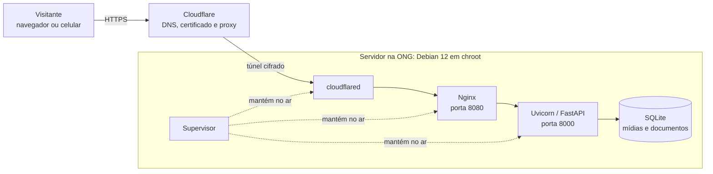

# 12 Implantação

Esta seção registra como o SigCECP foi colocado em produção: onde ele roda, como o acesso chega até ele, como é mantido e quais problemas apareceram durante a implantação.

O sistema foi publicado em **25/11/2026** no endereço **[https://sistema.centroesportivocecp.org](https://sistema.centroesportivocecp.org)**, com HTTPS. Nesta primeira fase, o site institucional atual do CECP (hospedado no Wix) continua no endereço principal, `centroesportivocecp.org`. O SigCECP passa a ocupar o endereço principal na fase 2 (seção 12.10), depois de rodar alguns dias na ONG sem problemas.

Em **26/11/2026**, o servidor foi instalado na sede da ONG, ligado à rede de lá, e os acessos foram entregues ao CECP (seção 12.5).

## 12.1 Visão geral

O sistema roda num servidor que fica na própria ONG. O acesso pela internet passa pela Cloudflare, que entrega o HTTPS e leva cada pedido por um túnel até o servidor. Como o túnel é aberto **de dentro do servidor para fora**, não é preciso abrir portas nem mexer no roteador da ONG.

O caminho de um acesso é:

1. A pessoa abre `https://sistema.centroesportivocecp.org`.
2. A Cloudflare responde com o certificado HTTPS e encaminha o pedido pelo túnel.
3. No servidor, o `cloudflared` entrega o pedido ao Nginx, na porta 8080.
4. O Nginx repassa ao Uvicorn, que executa a aplicação FastAPI na porta 8000.
5. A aplicação lê e grava no banco SQLite e nas pastas de mídias e documentos.

## 12.2 Servidor

| Item | Especificação |
| :--- | :--- |
| Equipamento | NAS Lenovo Iomega ix4-300d |
| Processador e memória | ARMv7 de 32 bits, dual core de 1,3 GHz; 512 MB de RAM |
| Armazenamento | 3 discos de 2 TB em **RAID 5** (cerca de 3,6 TB úteis), com **bitmap interno**; o sistema continua funcionando e sem perda de dados se um disco falhar |
| Sistema original | Firmware da Lenovo (Debian 7, kernel 3.2), de 2013 |
| Sistema da aplicação | **Debian 12** instalado numa pasta do volume de dados e executado com `chroot` |

O firmware original é antigo demais para rodar a aplicação: não tem Python moderno e não recebe atualizações. Por isso foi criado um Debian 12 completo dentro de uma pasta do servidor (`chroot`). Os programas da aplicação (Python 3.11, Nginx, SQLite e `cloudflared`) rodam nesse Debian e são atualizados com `apt`, enquanto o firmware da Lenovo continua cuidando dos discos e da rede. O kernel continua o antigo, e por isso nenhuma porta do servidor fica exposta à internet: todo o acesso externo passa pelo túnel.

## 12.3 Componentes

| Componente | Função | Onde fica (dentro do chroot) |
| :--- | :--- | :--- |
| Código do SigCECP | Aplicação FastAPI | `/srv/sigcecp/app` |
| Ambiente virtual | Dependências Python da aplicação | `/srv/sigcecp/app/.venv` |
| Banco de dados | SQLite em modo de produção | `/srv/sigcecp/data/sigcecp.db` |
| Mídias e documentos | Imagens e vídeos publicados (`backend/media`) e documentos dos alunos, cifrados (`backend/arquivos`) | Dentro de `/srv/sigcecp/app/backend` |
| Uvicorn | Servidor da aplicação, só em `127.0.0.1:8000` | Programa `sigcecp` no Supervisor |
| Nginx | Recebe o túnel na porta 8080 e repassa à aplicação; limite de 50 MB por envio de arquivo | `/etc/nginx/sites-available/sigcecp` |
| cloudflared | Túnel até a Cloudflare | `/root/.cloudflared/config.yml` |
| Supervisor | Sobe os três programas acima, reinicia se algum cair e guarda os logs | `/etc/supervisor/conf.d/` |
| rclone | Envia a cópia cifrada dos backups ao Google Drive da ONG | `/root/.config/rclone/rclone.conf` (permissão 600) |

A aplicação roda com o usuário de sistema `sigcecp`, sem senha e sem permissão de administrador.

## 12.4 Domínio e HTTPS

O domínio `centroesportivocecp.org` é do CECP, registrado na HostGator e gerenciado pelo José Ivan. Para usar o túnel, o DNS do domínio passou do Wix para a Cloudflare (plano gratuito):

| Etapa | O que foi feito |
| :--- | :--- |
| Cópia dos registros | A Cloudflare importou os registros que existiam no Wix: três registros A e o `www` (site atual), um registro A `mail` e um MX. Todos ficaram como **DNS only**, para o site do Wix continuar funcionando como antes |
| Troca dos servidores DNS | Na HostGator, os servidores `ns4.wixdns.net` e `ns5.wixdns.net` foram trocados pelos da Cloudflare. O registro e a renovação do domínio continuam na HostGator |
| Endereço do sistema | O comando `cloudflared tunnel route dns` criou o registro `sistema.centroesportivocecp.org`, apontando para o túnel |
| HTTPS | O certificado é emitido e renovado automaticamente pela Cloudflare; não há certificado para renovar no servidor |

Para desfazer a troca, basta colocar de volta os servidores DNS do Wix na HostGator.

**Acesso da ONG à Cloudflare:** o e-mail institucional do CECP foi convidado para a conta da Cloudflare como **Super Administrator** e aceitou o convite em 26/11/2026. Assim, a ONG tem controle total do DNS e do túnel, inclusive para gerenciar membros, sem depender de um integrante da equipe.

## 12.5 Configuração da aplicação

**Dependências:** o servidor usa o `requirements-prod.txt` do repositório (issue #82), só com os pacotes que o código importa (FastAPI, Uvicorn, SQLAlchemy, Alembic, bcrypt, python-dotenv, python-jose, python-multipart, Jinja2, MarkupSafe e cryptography). O `requirements.txt` completo não instala no processador ARM do servidor, porque alguns pacotes de desenvolvimento (`uvloop`, `httptools`) precisariam ser compilados e não são usados pela aplicação.

**Variáveis de ambiente:** ficam no arquivo `.env` da pasta do projeto, com permissão restrita, e **nunca** vão para o repositório. Os valores não são registrados nesta documentação.

| Variável | Uso |
| :--- | :--- |
| `APP_ENV` | `production` no servidor: exige HTTPS para os cookies de login |
| `AUTH_SECRET_KEY` | Assina as sessões da coordenação |
| `DATABASE_URL` | Caminho do banco SQLite |
| `DADOS_CHAVE` | Chave que cifra os dados de saúde e os documentos dos alunos ([RNF12](../escopo/rnf/RNF12.md)). Se for perdida, esses dados não podem mais ser lidos; por isso tem cópia guardada fora do servidor |
| `TRUSTED_ORIGINS` | Endereço aceito nos formulários (`https://sistema.centroesportivocecp.org`), usado na proteção contra CSRF |

**Banco de dados:** criado pelas migrações do Alembic (`alembic upgrade head`), como descrito no `readme.md` do código. O administrador inicial é criado com `python -m backend.auth.criar_admin`. A aplicação ativa em cada conexão a verificação de chaves estrangeiras (`PRAGMA foreign_keys`) e o modo `WAL`, que cria os arquivos `sigcecp.db-wal` e `sigcecp.db-shm` ao lado do banco (issue #83). A pasta do banco pertence ao usuário `sigcecp` e só ele tem acesso.

**Acessos e senhas:** nenhum valor é registrado nesta documentação. Todos estão guardados no gerenciador de senhas e foram entregues a um responsável do CECP em 26/11/2026.

| Acesso | Para quê | Observação |
| :--- | :--- | :--- |
| Administrador do SigCECP (`CECP0001`) | Entrar na área da coordenação | Para trocar a senha: `python -m backend.auth.criar_admin --usuario CECP0001 --redefinir-senha` (como `sigcecp`, no chroot); a troca encerra as sessões abertas |
| Administrador do painel da Lenovo | Painel web do servidor | A senha do `root` no SSH é sempre `soho` seguido dessa senha; para trocar a do `root`, troca-se a do painel (não usar `passwd`, que o firmware pode sobrescrever) |
| `DADOS_CHAVE` | Abrir os dados de saúde e os documentos dos alunos | Ver abaixo |
| Duas senhas do backup (`rclone`) | Decifrar a cópia do backup no Google Drive | Ver 12.7 |
| Conta Google da ONG | Drive com a cópia do backup | Também é a conta convidada na Cloudflare (12.4) |

As senhas do administrador do SigCECP e do painel foram trocadas em 26/11/2026, antes da entrega. O usuário de sistema `sigcecp` não tem senha, de propósito: só é acessado com `su` a partir do `root`.

**Chave `DADOS_CHAVE`:** guardada num gerenciador de senhas, com uma cópia a ser entregue à ONG. O valor só é exibido no terminal do servidor, nunca em conversas, mensagens ou documentos; para conferir se a cópia está certa, compara-se o `sha256sum` do valor no servidor com o da cópia. A chave não pode ser trocada com dados no banco, porque os dados já cifrados deixariam de abrir.

## 12.6 Inicialização e desligamento

| Situação | Como funciona |
| :--- | :--- |
| Servidor ligado | Uma tarefa `@reboot` em `/etc/cron.d/sigcecp` (no sistema da Lenovo, onde o arquivo é persistente) espera o volume de dados montar e executa `iniciar-chroot.sh`, que prepara o chroot, **atualiza o DNS do chroot** e inicia o Supervisor |
| Programa caiu | O Supervisor reinicia automaticamente |
| Desligamento | **Apertar e soltar o botão de energia** (ou desligar pelo painel da Lenovo). O desligamento do firmware chama o script `/etc/init.d/sigcecp-chroot` (ligado como `K05` em `rc0.d` e `rc6.d`), que executa `desligar-chroot.sh`: para os programas e desmonta o chroot antes de o firmware parar o RAID. Pelo terminal, o equivalente é `desligar-chroot.sh` seguido de `poweroff` |
| O que não fazer | Segurar o botão por 4 segundos (força o desligamento) ou tirar o servidor da tomada ligado |
| Queda de energia | O SQLite com `WAL` não corrompe o banco, e o bitmap do RAID faz a verificação dos discos levar minutos em vez de horas. Recomenda-se um nobreak com USB: o ix4-300d tem suporte e se desliga sozinho, de forma segura, quando falta energia |

**DNS do chroot:** a cada inicialização, o `iniciar-chroot.sh` reescreve o `/etc/resolv.conf` do chroot com o servidor DNS que a rede entregou ao firmware (o roteador do local onde o servidor estiver), seguido de `1.1.1.1` e `8.8.8.8` como reserva e de `options timeout:2`. Assim, o servidor funciona em qualquer rede, sem ajuste manual.

Os scripts `iniciar-chroot.sh` e `desligar-chroot.sh` ficam no volume de dados do servidor (`/mnt/pools/A/A0/`), e o registro de cada inicialização e desligamento fica em `iniciar-chroot.log`. O script de `/etc/init.d` e seus links ficam gravados em `/mnt/etc`, a parte persistente do `/etc` do firmware.

**Testes realizados em 26/11/2026:** reinício pelo comando e desligamento pelo botão. Nos dois casos, o log registrou o desligamento ordenado do chroot, o RAID voltou sem verificação, e o sistema subiu sozinho em cerca de 3 minutos.

## 12.7 Operação

**Atualizar o sistema com uma nova versão do código** (como usuário `sigcecp`, na pasta do projeto):

1. `git pull` na branch `main`, que é a de produção. Os comandos do Git rodam sempre como `sigcecp`: como administrador, o Git recusa o repositório (*dubious ownership*), e isso não deve ser contornado com `safe.directory`.
2. Se o `requirements-prod.txt` mudou: `.venv/bin/pip install -r requirements-prod.txt`.
3. Se há migrações novas em `alembic/versions/`: fazer um backup antes (como administrador, `/usr/local/bin/backup-sigcecp.sh`) e depois `.venv/bin/python -m alembic upgrade head`.
4. Como administrador: `supervisorctl restart sigcecp`.

**Backup automático:** o script `/usr/local/bin/backup-sigcecp.sh`, dentro do chroot, copia o banco pela API de backup do SQLite (cópia consistente mesmo com a aplicação rodando e com o modo `WAL`) e compacta as pastas `backend/media` e `backend/arquivos` (os documentos já ficam cifrados). Ele roda todo dia às 3h30, por uma linha em `/etc/cron.d/sigcecp` no sistema da Lenovo, e mantém os 7 backups mais recentes.

| Item | Local |
| :--- | :--- |
| Backups | `/srv/backups/sigcecp/AAAA-MM-DD_HHMM/` no chroot (no volume de dados: `/mnt/pools/A/A0/debian/srv/backups/sigcecp/`) |
| Registro de execução | `/mnt/pools/A/A0/backup-sigcecp.log` |
| Restaurar | Parar a aplicação, copiar o `sigcecp.db` do backup para `/srv/sigcecp/data/` (dono `sigcecp`), extrair o `arquivos.tar.gz` em `backend/` e iniciar a aplicação |

**Cópia fora do servidor:** logo após o backup local, o mesmo script envia a pasta do dia para o **Google Drive da ONG** com o `rclone`, numa pasta cifrada (`SigCecp-backups`): o Google vê só nomes e conteúdos embaralhados. No Drive ficam os últimos 30 dias. Se o envio falhar (por exemplo, sem internet), o backup local é mantido e o log registra o erro. O acesso ao Drive usa a permissão `drive.file`: o rclone só enxerga os arquivos que ele mesmo criou.

| Item | Local |
| :--- | :--- |
| Cópia cifrada | Google Drive da ONG, pasta `SigCecp-backups` (remoto `backup-cifrado:` no rclone) |
| Senhas da cifragem | Duas senhas (`password` e `password2`) guardadas no gerenciador de senhas, nunca no repositório |

**Restaurar a partir do Drive** (se o servidor for perdido), em qualquer computador:

1. Instalar o rclone e criar um remoto do Google Drive com a conta da ONG (`rclone config`, permissão `drive.file`).
2. Criar um remoto `crypt` apontando para `<remoto do drive>:SigCecp-backups`, com as duas senhas guardadas.
3. Baixar a pasta desejada: `rclone copy backup-cifrado:AAAA-MM-DD_HHMM ./restauracao`.
4. Instalar o sistema normalmente e usar o `sigcecp.db` e o `arquivos.tar.gz` baixados. A `DADOS_CHAVE` original é obrigatória para abrir os dados de saúde e os documentos.

Sem a conta Google da ONG, as duas senhas do rclone e a `DADOS_CHAVE`, os backups do Drive não podem ser usados. Os três ficam fora do servidor.

**Acesso de manutenção:** o SSH fica **desligado**. Para atualizar o código ou consultar logs:

1. Na rede da ONG, descobrir o IP do servidor no visor do NAS (os botões ao lado da tela passam as informações).
2. Abrir `http://IP/manage/diagnostics.html` no navegador, entrar com o administrador do painel e habilitar o acesso remoto (SSH). Nesta versão do firmware, a página fica em `/manage`; o endereço `/diagnostics.html` dá "página não encontrada".
3. Conectar com `ssh root@IP`; a senha é `soho` seguido da senha do painel.
4. Ao terminar, desabilitar o SSH na mesma página.

A aplicação não depende do SSH.

**Teste de carga (25 e 26/11/2026):** com o Locust, pela rede local, 50 visitantes simultâneos nas páginas públicas e, pelo HTTPS, 10 coordenadores logados ao mesmo tempo foram atendidos sem nenhuma falha ([RNF08](../escopo/rnf/RNF08.md)). Numa carga bem maior, o teste revelou um travamento do servidor, corrigido na issue #87 (12.9).

**Consultas do dia a dia** (como administrador, no chroot):

| Comando | Para quê |
| :--- | :--- |
| `supervisorctl status` | Ver se `sigcecp`, `nginx` e `cloudflared` estão rodando |
| `supervisorctl restart sigcecp` | Reiniciar a aplicação |
| `tail -50 /var/log/sigcecp.err.log` | Ver erros da aplicação |
| `tail -50 /var/log/cloudflared.err.log` | Ver o estado do túnel |
| `cat /proc/mdstat` (fora do chroot) | Ver o estado dos discos e do RAID; a linha `bitmap` confirma o bitmap ativo |
| `cat /mnt/pools/A/A0/backup-sigcecp.log` (fora do chroot) | Ver se o backup e o envio ao Drive da madrugada deram certo (horário em UTC) |

## 12.8 Decisões de implantação

| Decisão | Alternativas consideradas | Justificativa |
| :--- | :--- | :--- |
| Servidor próprio na ONG (NAS) | Hospedagem paga em nuvem | Implantação em servidor próprio da ONG, como combinado com o cliente, sem custo mensal de hospedagem |
| Debian 12 em `chroot` | Usar o firmware original; instalar o Debian no lugar do firmware | O firmware não roda a aplicação. Trocar o firmware exige cabo serial e, se falhar, deixa o servidor sem ligar. O `chroot` dá um sistema atualizado sem mexer no boot do servidor |
| SQLite | MySQL | Não consome memória com um servidor de banco, o que importa com 512 MB de RAM, e atende à carga prevista de até 10 sessões simultâneas ([RNF08](../escopo/rnf/RNF08.md)) |
| Supervisor | systemd; Docker | O systemd não funciona dentro do `chroot`, e o Docker exige um kernel mais novo que o do servidor |
| Cloudflare Tunnel | Abrir portas no roteador da ONG | Não expõe o servidor nem o kernel antigo à internet, entrega HTTPS automaticamente e funciona em qualquer rede, sem configurar o roteador |
| Subdomínio `sistema` antes do domínio principal | Substituir o site do Wix de imediato | Permite testar a produção sem tirar do ar o site atual do CECP; a troca do domínio principal leva poucos minutos quando o sistema estiver estável |
| Cópia do backup no Google Drive da ONG, cifrada com rclone | HD externo USB no servidor; computador de um integrante da equipe | Fica fora do local físico do servidor (protege contra roubo, incêndio e queima), é automática e gratuita, e pertence à ONG, não a um integrante. A cifragem protege os dados pessoais dos alunos no serviço do Google |
| Desligamento pelo botão chamando o script do chroot | Ensinar o uso do terminal à ONG | As pessoas da ONG não são da área de TI; o botão é o jeito natural de desligar o servidor e agora é seguro |
| Rotas que usam o banco como `def` (ou com `run_in_threadpool`) | SQLAlchemy assíncrono (`AsyncSession` com `aiosqlite`) | Correção pequena, recomendada pela documentação do FastAPI e no padrão que o projeto já usava; o modo assíncrono exigiria reescrever serviços e testes, com pouco ganho num SQLite local |

## 12.9 Problemas encontrados e soluções

| Problema | Causa | Solução |
| :--- | :--- | :--- |
| Servidor não aparecia na rede | Estava com IP fixo de outra rede, configurado por um dono anterior | Endereço descoberto pelos anúncios de rede (ARP) do servidor; redefinição de fábrica, que voltou a rede para IP automático |
| Disco 1 com defeito | O disco passou a informar 3,86 GB em vez de 2 TB | Disco retirado; RAID 5 montado com os 3 discos bons |
| Relógio do servidor 1 hora adiantado | O firmware de 2013 ainda aplica o horário de verão de Brasília | Fuso trocado para outro GMT−03:00 sem horário de verão |
| Aplicação quebrava num clone novo | A pasta `backend/media` está no `.gitignore` e não existe num clone novo | Pasta criada no servidor e, depois, o código passou a criá-la ao iniciar (issue #81) |
| Página sem CSS e redirecionamentos para a porta errada | O Nginx repassava o cabeçalho `Host` sem a porta, e os links gerados por `url_for` saíam sem ela | `proxy_set_header Host $http_host` |
| Erro 500 no login (`no such column: administradores.nome`) | Código atualizado sem aplicar as migrações novas | `alembic upgrade head`; a atualização passou a incluir esse passo (12.7) |
| Login recusado (401) pelo endereço local | Em produção, o cookie de sessão só é aceito por HTTPS | Esperado: o login em produção é feito pelo endereço com HTTPS |
| Sistema não subia sozinho ao ligar o servidor | O firmware da Lenovo apaga o crontab do root a cada reinício | Tarefa movida para `/etc/cron.d`, que é persistente |
| Verificação completa do RAID (cerca de 18 horas) depois de reiniciar | Desligamento sem parar os programas do `chroot` | Script de desligamento chamado pelo próprio desligamento do firmware (12.6) e bitmap do RAID, ativado em 26/11/2026 |
| Túnel sem acesso à aplicação | No `chroot`, `localhost` apontava só para o endereço IPv6, e o Nginx escuta em IPv4 | Túnel configurado para `127.0.0.1:8080` |
| Git recusava o repositório (`detected dubious ownership`) | Comandos do Git executados como administrador num repositório do usuário `sigcecp` | Executar o Git sempre como `sigcecp` (12.7), sem exceção de `safe.directory` |
| Linha do backup duplicada no cron | `/etc/cron.d/sigcecp` e `/mnt/etc/cron.d/sigcecp` são o mesmo arquivo, e a linha foi adicionada nos dois caminhos | Linha duplicada removida; basta editar um dos caminhos |
| Valor da `DADOS_CHAVE` exibido fora do terminal durante a configuração | A chave foi copiada para um canal que não é seguro | Como ainda não havia dados reais, o banco de testes foi apagado, uma chave nova foi gerada direto no `.env` sem aparecer na tela e o banco foi recriado; a chave nova foi guardada no gerenciador de senhas |
| Servidor travava sob carga e só voltava reiniciando (`QueuePool limit of size 5 overflow 10 reached`) | Rotas `async def` consultavam o banco de forma síncrona, bloqueando o laço de eventos; sob carga, as 15 conexões do pool se esgotavam e o servidor congelava | Rotas passaram a `def` ou levam o banco para uma thread com `run_in_threadpool`, e um teste impede a regressão (issue #87, PR #88). Depois da correção, 1000 requisições simultâneas foram atendidas |
| Desligar pelo botão não parava os programas do chroot | O firmware da Lenovo não conhece o chroot | Script `/etc/init.d/sigcecp-chroot` ligado como `K05` em `rc0.d` e `rc6.d` (12.6) |
| Script de desligamento com erro de sintaxe | O terminal do firmware quebrou uma linha de comentário com caractere acentuado | Scripts do servidor escritos sem acentos e conferidos com `sh -n` |
| Configuração do rclone gravada em `/.config` | Dentro do chroot, a variável `HOME` não está definida | Arquivo movido para `/root/.config/rclone/` com permissão 600; o script de backup define `RCLONE_CONFIG` |
| Senha de cifragem do backup exibida fora do terminal | A saída da configuração do rclone foi copiada para um canal que não é seguro | Remoto cifrado recriado com senhas novas antes do primeiro envio ao Drive |
| Arquivo `/mnt/system/config/exports` esvaziado | A saída de um comando foi colada de volta no terminal, e as linhas com `->` viraram redirecionamentos do shell | Arquivo restaurado da cópia `exports.prev` gerada pelo firmware; nunca colar saída de comandos no terminal |
| Na ONG, o site mostrava "Error 1033" da Cloudflare (túnel desconectado) | O `/etc/resolv.conf` do chroot guardava o DNS do provedor da rede onde o Debian foi instalado; na rede da ONG, esse servidor não respondia, e o `cloudflared` não conseguia encontrar a Cloudflare. A internet funcionava (o `ping` para `1.1.1.1` respondia) | DNS do chroot trocado na hora e, de forma definitiva, o `iniciar-chroot.sh` passou a atualizá-lo a cada inicialização (12.6). Confirmado com desligamento e religamento pelo botão na rede da ONG |
| Endereço novo não abria em algumas redes logo após a publicação | Servidores DNS de operadoras guardavam a resposta anterior em cache | Resolve-se sozinho quando o cache expira; testes feitos pelo 4G |

## 12.10 Pendências

| Pendência | Situação |
| :--- | :--- |
| Ativar o bitmap do RAID, para que um desligamento inesperado não exija a verificação completa dos discos | Concluída em 26/11/2026 |
| Teste de reinício completo: desligar com o script, ligar e conferir se tudo volta sozinho | Concluída em 26/11/2026 (pelo comando e pelo botão) |
| Desligamento seguro pelo botão, sem terminal | Concluída em 26/11/2026 |
| Backup automático diário do banco e das pastas de mídias e documentos (12.7) | Concluída em 25/11/2026 |
| Cópia periódica do backup para fora do servidor | Concluída em 26/11/2026 (Google Drive da ONG, cifrada, últimos 30 dias) |
| Versão estável em produção: o servidor passou a rodar a branch `main`, com a versão final do projeto (PR #65) | Concluída em 25/11/2026 |
| Issues de produção no código: criar `backend/media` ao iniciar, separar dependências de produção, ativar `PRAGMA foreign_keys` no SQLite, `render_as_batch` no Alembic e desligar o `/docs` em produção | Concluída em 25/11/2026 (issues #81 a #85, PR #86); servidor atualizado |
| Troca da `DADOS_CHAVE` e cópia em gerenciador de senhas | Concluída em 25/11/2026 |
| Correção do travamento do servidor sob carga | Concluída em 26/11/2026 (issue #87, PR #88); servidor atualizado |
| Entregar à ONG uma cópia da `DADOS_CHAVE` e das duas senhas de cifragem do backup | Concluída em 26/11/2026, junto com as senhas do administrador do SigCECP e do painel |
| Trocar as senhas do painel (e do `root`) e do administrador do SigCECP antes da entrega | Concluída em 26/11/2026 |
| Fechar o SSH no painel da Lenovo | Concluída em 26/11/2026 |
| Levar o servidor para a ONG e testar na rede de lá | Concluída em 26/11/2026 (com a correção do DNS do chroot) |
| Fase 2: apontar `centroesportivocecp.org` e `www` para o SigCECP, no lugar do site do Wix | Depois de alguns dias de funcionamento estável na ONG |
| Dar acesso de administrador à conta da Cloudflare para uma pessoa do CECP | Concluída em 26/11/2026 (e-mail institucional do CECP como Super Administrator) |
| Aviso automático quando o site sair do ar (monitor de disponibilidade) | Opcional |
| Nobreak com USB para o servidor | Recomendado à ONG |

## Versionamento

| Versão | Data | Descrição | Autor(es/as) | Revisor(es/as) |
| :--- | :--- | :--- | :--- | :--- |
| 1.0 | 25/11/2026 | Documento inicial: arquitetura, servidor, domínio, configuração, operação, decisões, problemas e pendências da implantação | [Marcos Monteiro](https://github.com/montmarcos) |  |
| 1.1 | 25/11/2026 | Servidor atualizado para a branch `main` (versão final); procedimento de atualização e problemas ajustados | [Marcos Monteiro](https://github.com/montmarcos) |  |
| 1.2 | 25/11/2026 | Backup automático, cuidados com a `DADOS_CHAVE` e sua troca, correções de produção (issues #81 a #85) e pendências atualizadas | [Marcos Monteiro](https://github.com/montmarcos) |  |
| 1.3 | 26/11/2026 | Bitmap do RAID, testes de reinício, desligamento seguro pelo botão, cópia cifrada do backup no Google Drive com procedimento de restauração, SSH fechado, teste de carga e correção do travamento sob carga (issue #87) | [Marcos Monteiro](https://github.com/montmarcos) |  |
| 1.4 | 26/11/2026 | Instalação na ONG: correção do DNS do chroot, acesso de manutenção pela página de diagnóstico, troca de senhas, entrega dos acessos e acesso da ONG à Cloudflare | [Marcos Monteiro](https://github.com/montmarcos) |  |