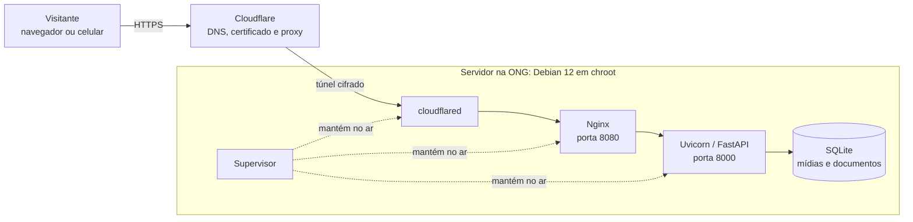

# 12 Implantação

Esta seção registra como o SigCECP foi colocado em produção: onde ele roda, como o acesso chega até ele, como é mantido e quais problemas apareceram durante a implantação.

O sistema foi publicado em **25/11/2026** no endereço **[https://sistema.centroesportivocecp.org](https://sistema.centroesportivocecp.org)**, com HTTPS. Nesta primeira fase, o site institucional atual do CECP (hospedado no Wix) continua no endereço principal, `centroesportivocecp.org`. O SigCECP passa a ocupar o endereço principal na fase 2 (seção 12.10), depois de rodar alguns dias na ONG sem problemas.

## 12.1 Visão geral

O sistema roda num servidor que fica na própria ONG. O acesso pela internet passa pela Cloudflare, que entrega o HTTPS e leva cada pedido por um túnel até o servidor. Como o túnel é aberto **de dentro do servidor para fora**, não é preciso abrir portas nem mexer no roteador da ONG.

O caminho de um acesso é:

1. A pessoa abre `https://sistema.centroesportivocecp.org`.
2. A Cloudflare responde com o certificado HTTPS e encaminha o pedido pelo túnel.
3. No servidor, o `cloudflared` entrega o pedido ao Nginx, na porta 8080.
4. O Nginx repassa ao Uvicorn, que executa a aplicação FastAPI na porta 8000.
5. A aplicação lê e grava no banco SQLite e nas pastas de mídias e documentos.

## 12.2 Servidor

| Item | Especificação |
| :--- | :--- |
| Equipamento | NAS Lenovo Iomega ix4-300d |
| Processador e memória | ARMv7 de 32 bits, dual core de 1,3 GHz; 512 MB de RAM |
| Armazenamento | 3 discos de 2 TB em **RAID 5** (cerca de 3,6 TB úteis); o sistema continua funcionando e sem perda de dados se um disco falhar |
| Sistema original | Firmware da Lenovo (Debian 7, kernel 3.2), de 2013 |
| Sistema da aplicação | **Debian 12** instalado numa pasta do volume de dados e executado com `chroot` |

O firmware original é antigo demais para rodar a aplicação: não tem Python moderno e não recebe atualizações. Por isso foi criado um Debian 12 completo dentro de uma pasta do servidor (`chroot`). Os programas da aplicação (Python 3.11, Nginx, SQLite e `cloudflared`) rodam nesse Debian e são atualizados com `apt`, enquanto o firmware da Lenovo continua cuidando dos discos e da rede. O kernel continua o antigo, e por isso nenhuma porta do servidor fica exposta à internet: todo o acesso externo passa pelo túnel.

## 12.3 Componentes

| Componente | Função | Onde fica (dentro do chroot) |
| :--- | :--- | :--- |
| Código do SigCECP | Aplicação FastAPI | `/srv/sigcecp/app` |
| Ambiente virtual | Dependências Python da aplicação | `/srv/sigcecp/app/.venv` |
| Banco de dados | SQLite em modo de produção | `/srv/sigcecp/data/sigcecp.db` |
| Mídias e documentos | Imagens e vídeos publicados (`backend/media`) e documentos dos alunos, cifrados (`backend/arquivos`) | Dentro de `/srv/sigcecp/app/backend` |
| Uvicorn | Servidor da aplicação, só em `127.0.0.1:8000` | Programa `sigcecp` no Supervisor |
| Nginx | Recebe o túnel na porta 8080 e repassa à aplicação; limite de 50 MB por envio de arquivo | `/etc/nginx/sites-available/sigcecp` |
| cloudflared | Túnel até a Cloudflare | `/root/.cloudflared/config.yml` |
| Supervisor | Sobe os três programas acima, reinicia se algum cair e guarda os logs | `/etc/supervisor/conf.d/` |

A aplicação roda com o usuário de sistema `sigcecp`, sem senha e sem permissão de administrador.

## 12.4 Domínio e HTTPS

O domínio `centroesportivocecp.org` é do CECP, registrado na HostGator e gerenciado pelo José Ivan. Para usar o túnel, o DNS do domínio passou do Wix para a Cloudflare (plano gratuito):

| Etapa | O que foi feito |
| :--- | :--- |
| Cópia dos registros | A Cloudflare importou os registros que existiam no Wix: três registros A e o `www` (site atual), um registro A `mail` e um MX. Todos ficaram como **DNS only**, para o site do Wix continuar funcionando como antes |
| Troca dos servidores DNS | Na HostGator, os servidores `ns4.wixdns.net` e `ns5.wixdns.net` foram trocados pelos da Cloudflare. O registro e a renovação do domínio continuam na HostGator |
| Endereço do sistema | O comando `cloudflared tunnel route dns` criou o registro `sistema.centroesportivocecp.org`, apontando para o túnel |
| HTTPS | O certificado é emitido e renovado automaticamente pela Cloudflare; não há certificado para renovar no servidor |

Para desfazer a troca, basta colocar de volta os servidores DNS do Wix na HostGator.

## 12.5 Configuração da aplicação

**Dependências:** o servidor usa um `requirements-prod.txt` só com os pacotes que o código importa (FastAPI, Uvicorn, SQLAlchemy, Alembic, bcrypt, python-dotenv, python-jose, python-multipart, Jinja2, MarkupSafe e cryptography). O `requirements.txt` completo não instala no processador ARM do servidor, porque alguns pacotes de desenvolvimento (`uvloop`, `httptools`) precisariam ser compilados e não são usados pela aplicação.

**Variáveis de ambiente:** ficam no arquivo `.env` da pasta do projeto, com permissão restrita, e **nunca** vão para o repositório. Os valores não são registrados nesta documentação.

| Variável | Uso |
| :--- | :--- |
| `APP_ENV` | `production` no servidor: exige HTTPS para os cookies de login |
| `AUTH_SECRET_KEY` | Assina as sessões da coordenação |
| `DATABASE_URL` | Caminho do banco SQLite |
| `DADOS_CHAVE` | Chave que cifra os dados de saúde e os documentos dos alunos ([RNF12](../escopo/rnf/RNF12.md)). Se for perdida, esses dados não podem mais ser lidos; por isso tem cópia guardada fora do servidor |
| `TRUSTED_ORIGINS` | Endereço aceito nos formulários (`https://sistema.centroesportivocecp.org`), usado na proteção contra CSRF |

**Banco de dados:** criado pelas migrações do Alembic (`alembic upgrade head`), como descrito no `readme.md` do código. O administrador inicial é criado com `python -m backend.auth.criar_admin`.

## 12.6 Inicialização e desligamento

| Situação | Como funciona |
| :--- | :--- |
| Servidor ligado | Uma tarefa `@reboot` em `/etc/cron.d/sigcecp` (no sistema da Lenovo, onde o arquivo é persistente) espera o volume de dados montar e executa `iniciar-chroot.sh`, que prepara o chroot e inicia o Supervisor |
| Programa caiu | O Supervisor reinicia automaticamente |
| Desligamento | Antes de desligar, executar `desligar-chroot.sh`, que para os programas e desmonta o chroot. Desligar sem isso faz o RAID refazer a verificação completa dos discos no próximo boot |

Os dois scripts ficam no volume de dados do servidor, e o registro de cada inicialização fica em `iniciar-chroot.log`.

## 12.7 Operação

**Atualizar o sistema com uma nova versão do código** (como usuário `sigcecp`, na pasta do projeto):

1. `git pull` na branch `main`, que é a de produção. Os comandos do Git rodam sempre como `sigcecp`: como administrador, o Git recusa o repositório (*dubious ownership*), e isso não deve ser contornado com `safe.directory`.
2. Se o `requirements-prod.txt` mudou: `.venv/bin/pip install -r requirements-prod.txt`.
3. Se há migrações novas em `alembic/versions/`: fazer backup do banco (`sqlite3 ... ".backup ..."`) e depois `.venv/bin/python -m alembic upgrade head`.
4. Como administrador: `supervisorctl restart sigcecp`.

**Consultas do dia a dia** (como administrador, no chroot):

| Comando | Para quê |
| :--- | :--- |
| `supervisorctl status` | Ver se `sigcecp`, `nginx` e `cloudflared` estão rodando |
| `supervisorctl restart sigcecp` | Reiniciar a aplicação |
| `tail -50 /var/log/sigcecp.err.log` | Ver erros da aplicação |
| `tail -50 /var/log/cloudflared.err.log` | Ver o estado do túnel |
| `cat /proc/mdstat` (fora do chroot) | Ver o estado dos discos e do RAID |

## 12.8 Decisões de implantação

| Decisão | Alternativas consideradas | Justificativa |
| :--- | :--- | :--- |
| Servidor próprio na ONG (NAS) | Hospedagem paga em nuvem | Implantação em servidor próprio da ONG, como combinado com o cliente, sem custo mensal de hospedagem |
| Debian 12 em `chroot` | Usar o firmware original; instalar o Debian no lugar do firmware | O firmware não roda a aplicação. Trocar o firmware exige cabo serial e, se falhar, deixa o servidor sem ligar. O `chroot` dá um sistema atualizado sem mexer no boot do servidor |
| SQLite | MySQL | Não consome memória com um servidor de banco, o que importa com 512 MB de RAM, e atende à carga prevista de até 10 sessões simultâneas ([RNF08](../escopo/rnf/RNF08.md)) |
| Supervisor | systemd; Docker | O systemd não funciona dentro do `chroot`, e o Docker exige um kernel mais novo que o do servidor |
| Cloudflare Tunnel | Abrir portas no roteador da ONG | Não expõe o servidor nem o kernel antigo à internet, entrega HTTPS automaticamente e funciona em qualquer rede, sem configurar o roteador |
| Subdomínio `sistema` antes do domínio principal | Substituir o site do Wix de imediato | Permite testar a produção sem tirar do ar o site atual do CECP; a troca do domínio principal leva poucos minutos quando o sistema estiver estável |

## 12.9 Problemas encontrados e soluções

| Problema | Causa | Solução |
| :--- | :--- | :--- |
| Servidor não aparecia na rede | Estava com IP fixo de outra rede, configurado por um dono anterior | Endereço descoberto pelos anúncios de rede (ARP) do servidor; redefinição de fábrica, que voltou a rede para IP automático |
| Disco 1 com defeito | O disco passou a informar 3,86 GB em vez de 2 TB | Disco retirado; RAID 5 montado com os 3 discos bons |
| Relógio do servidor 1 hora adiantado | O firmware de 2013 ainda aplica o horário de verão de Brasília | Fuso trocado para outro GMT−03:00 sem horário de verão |
| Aplicação quebrava num clone novo | A pasta `backend/media` está no `.gitignore` e não existe num clone novo | Pasta criada no servidor; proposta issue para o código criá-la ao iniciar |
| Página sem CSS e redirecionamentos para a porta errada | O Nginx repassava o cabeçalho `Host` sem a porta, e os links gerados por `url_for` saíam sem ela | `proxy_set_header Host $http_host` |
| Erro 500 no login (`no such column: administradores.nome`) | Código atualizado sem aplicar as migrações novas | `alembic upgrade head`; a atualização passou a incluir esse passo (12.7) |
| Login recusado (401) pelo endereço local | Em produção, o cookie de sessão só é aceito por HTTPS | Esperado: o login em produção é feito pelo endereço com HTTPS |
| Sistema não subia sozinho ao ligar o servidor | O firmware da Lenovo apaga o crontab do root a cada reinício | Tarefa movida para `/etc/cron.d`, que é persistente |
| Verificação completa do RAID (cerca de 18 horas) depois de reiniciar | Desligamento sem parar os programas do `chroot` | Script de desligamento (12.6) e bitmap do RAID (pendência em 12.10) |
| Túnel sem acesso à aplicação | No `chroot`, `localhost` apontava só para o endereço IPv6, e o Nginx escuta em IPv4 | Túnel configurado para `127.0.0.1:8080` |
| Git recusava o repositório (`detected dubious ownership`) | Comandos do Git executados como administrador num repositório do usuário `sigcecp` | Executar o Git sempre como `sigcecp` (12.7), sem exceção de `safe.directory` |
| Endereço novo não abria em algumas redes logo após a publicação | Servidores DNS de operadoras guardavam a resposta anterior em cache | Resolve-se sozinho quando o cache expira; testes feitos pelo 4G |

## 12.10 Pendências

| Pendência | Situação |
| :--- | :--- |
| Ativar o bitmap do RAID, para que um desligamento inesperado não exija a verificação completa dos discos | Aguardando o fim da sincronização do RAID |
| Teste de reinício completo: desligar com o script, ligar e conferir se tudo volta sozinho | Depois do bitmap |
| Backup automático do banco e das pastas de mídias e documentos, com cópia fora do servidor | Scripts em preparação |
| Versão estável em produção: o servidor passou a rodar a branch `main`, com a versão final do projeto (PR #65) | Concluída em 25/11/2026 |
| Issues de produção no código: criar `backend/media` ao iniciar, separar dependências de produção, ativar `PRAGMA foreign_keys` no SQLite, `render_as_batch` no Alembic e desligar o `/docs` em produção | A abrir |
| Levar o servidor para a ONG e testar na rede de lá | Depois do teste de reinício |
| Fase 2: apontar `centroesportivocecp.org` e `www` para o SigCECP, no lugar do site do Wix | Depois de alguns dias de funcionamento estável na ONG |
| Dar acesso de administrador à conta da Cloudflare para uma pessoa do CECP | A fazer |

## Versionamento

| Versão | Data | Descrição | Autor(es/as) | Revisor(es/as) |
| :--- | :--- | :--- | :--- | :--- |
| 1.0 | 25/11/2026 | Documento inicial: arquitetura, servidor, domínio, configuração, operação, decisões, problemas e pendências da implantação | [Marcos Monteiro](https://github.com/montmarcos) |  |
| 1.1 | 25/11/2026 | Servidor atualizado para a branch `main` (versão final); procedimento de atualização e problemas ajustados | [Marcos Monteiro](https://github.com/montmarcos) |  |
