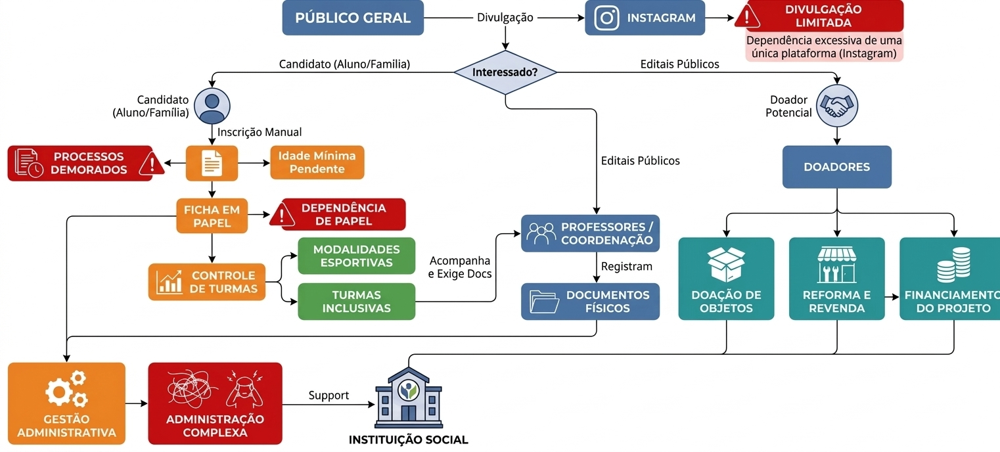
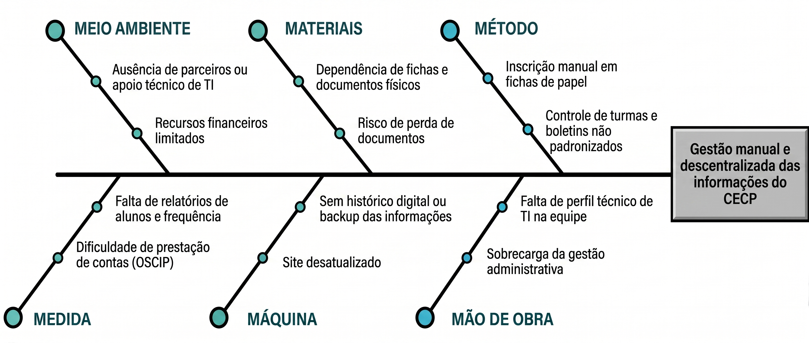

# VISÃO DO PRODUTO E PROJETO

## 1 CENÁRIO ATUAL DO CLIENTE E DO NEGÓCIO

### 1.1 Identificação do Cliente/Parceiro

**Nome:** Centro Esportivo Cultural de Planaltina

**Tipo:** Organização da Sociedade Civil de Interesse Público

**Representante:** Pedro Augusto Cajado Coutinho.

**Forma de contato:** Reuniões periódicas por videoconferência, canal de mensagens instantânea e email.

**Vínculo com o projeto:** Cliente real e parte interessada principal, responsável por fornecer informações sobre o negócio, validar as decisões do projeto e avaliar as entregas realizadas ao longo do desenvolvimento.

### 1.2 Introdução ao Negócio e Contexto

O Centro Esportivo Cultural de Planaltina DF (CECP) é uma organização social brasileira que atua no Distrito Federal desde 2014. Qualificada como Organização da Sociedade Civil de Interesse Público (OSCIP) junto ao Ministério da Justiça, a instituição utiliza as Artes Marciais como ferramenta de prevenção à criminalidade e de promoção do desenvolvimento sociocultural e esportivo da comunidade.

A organização opera de forma presencial, em Planaltina-DF, onde são realizadas as atividades em regime de contraturno escolar. O trabalho é sustentado por um grupo de jovens voluntários, lutadores e profissionais de diversas áreas. Sua presença digital é limitada e fragmentada: o Instagram é o principal canal de divulgação. Embora o domínio e o site institucional permaneçam ativos, o site está desatualizado e não é mais utilizado. Não há, atualmente, uma estrutura digital integrada para a gestão de alunos, documentos, doações e informações institucionais.

A missão do CECP é comprometer jovens líderes com o desenvolvimento da comunidade, formando uma consciência social verdadeira por meio de ações positivas em favor da infância mais necessitada, tendo como valores centrais a amizade, o respeito, a sinceridade e a solidariedade.

O público-alvo principal são crianças e adolescentes, bem como suas famílias, em situação de vulnerabilidade social, sobretudo de baixa renda, em regiões próximas de Planaltina. O acompanhamento escolar e disciplinar ainda ocorre de maneira predominantemente informal, sem sistema digital, verificação sistemática ou controle estruturado de frequência. O funcionamento atual desse acompanhamento é detalhado na seção 1.3.

### 1.3 Rich Picture

*Figura 1 – Rich Picture*
*Produzido pelos autores – 2026*

A Figura 1 apresenta o mapeamento do fluxo atual de operação do CECP, elaborado a partir do levantamento realizado junto à organização, contemplando os processos de captação de alunos, matrícula, gestão de turmas, captação de doadores e administração geral.

O cenário atual envolve o público geral, que toma conhecimento do projeto principalmente pelo Instagram; crianças e adolescentes candidatos ou participantes, seus pais ou responsáveis; professores e coordenação; administradores e funcionários; doadores financeiros; doadores de objetos; e fontes de apoio e financiamento, como editais públicos, órgãos públicos e entidades de apoio social. Esses atores se relacionam com a instituição em processos de divulgação, participação nas atividades, gestão administrativa, doações e busca de recursos.

No fluxo de alunos representado na Figura 1, o cadastro é predominantemente manual e realizado por ficha física. O possível aluno participa de uma aula experimental e, depois dela, a equipe pode fazer contato pelo WhatsApp. Na aula seguinte, são apresentados os documentos físicos necessários, que são assinados presencialmente. Houve tentativa anterior de uso de formulário do Google, mas o papel continua presente em grande parte do processo. Alguns documentos são digitalizados e armazenados em pastas no computador. Essa digitalização ocorre de forma pontual, sem critérios ou regras definidos para determinar quais documentos devem ser digitalizados. Em certas situações, documentos já digitalizados precisam ser impressos novamente.

#### Acompanhamento pedagógico e disciplinar atual

Professores e coordenação acompanham as modalidades esportivas e as turmas inclusivas. A instituição precisa manter informações de alunos ativos e ex-alunos.

A comprovação de bom desempenho escolar é exigida para a progressão de faixa dos alunos. Entretanto, a ONG não possui sistema digital nem verificação sistemática dessa condição; o acompanhamento depende, em grande parte, da boa-fé do aluno.

Quando ocorre um comportamento considerado inadequado, o professor que acompanha o caso conversa primeiro com o aluno para compreender a situação antes de aplicar qualquer sanção. Não existe escala padronizada de sanções nem critérios objetivos formalizados: a decisão sobre eventual medida é tomada por cada professor, de forma subjetiva e conforme as particularidades do caso.

Em algumas situações, o professor busca discutir o caso com os demais professores, como um comitê informal. Essa discussão coletiva não é um procedimento formalizado e não é seguida de maneira consistente. Atualmente, também não existe histórico estruturado das conversas realizadas ou das medidas disciplinares aplicadas; assim, outro professor que assuma a turma não consegue consultar ocorrências anteriores do aluno.

Além disso, a organização ainda não possui controle estruturado de frequência, o que dificulta acompanhar a presença e emitir comprovações de participação quando necessário.

O fluxo de apoio e doações segue caminhos distintos. Doadores financeiros realizam contribuições diretas para sustentar o projeto; doadores de objetos contribuem com bens que podem passar por reforma e revenda para geração de recursos. Editais públicos, órgãos públicos e entidades de apoio social constituem fontes de apoio ou financiamento dos recursos do projeto, sem conexão operacional direta com a coordenação. Todos esses fluxos demandam administração e organização institucional.

Os efeitos da descentralização representada no diagrama são analisados na seção 1.4; os desafios de implantação, na seção 1.5.

A organização também apresenta algumas restrições relevantes para o projeto, como a atuação de uma equipe voluntária, a ausência de uma estrutura própria de tecnologia da informação, a limitação de recursos financeiros para aquisição e manutenção de sistemas comerciais e a necessidade de uma solução compatível com a realidade operacional da instituição.

### 1.4 Identificação da Oportunidade ou Problema

*Figura 2 – Diagrama de Ishikawa*
*Produzido pelos autores – 2026*

A Figura 2 apresenta o diagrama de Ishikawa, um mapa que mostra os principais agentes responsáveis pelo problema enfrentado pela organização, elaborado a partir do levantamento realizado junto à organização, contemplando as principais dificuldades enfrentadas pelos organizadores e colaboradores da organização.

A partir do cenário e dos fluxos descritos em 1.2 e 1.3, a Figura 2 organiza as causas das dificuldades de gestão. A falta de integração entre os registros aumenta o trabalho necessário para localizar, atualizar e preservar informações, com risco de perdas e desorganização. O crescimento do volume de dados amplia esse esforço administrativo.

Nas doações, a ausência de controle estruturado dificulta acompanhar contribuições e doadores. Na divulgação, a desatualização e a organização insuficiente das informações institucionais dificultam apresentar os projetos e resultados e podem limitar a participação em determinados editais.

A oportunidade é centralizar a consulta e a organização dos registros e melhorar a apresentação pública das informações. A solução proposta e os limites de sua entrega inicial estão na [seção 2](2_solucao_proposta.md).

### 1.5 Desafios do Projeto

O projeto enfrenta três desafios principais:

**Desafio 1 - Modernização da presença digital institucional:** Estruturar uma apresentação acessível e organizada das atividades e dos resultados, adequada às necessidades da comunidade e às informações exigidas em possíveis editais. O diagnóstico dos canais existentes está em 1.2.

**Desafio 2 - Digitalização da gestão administrativa:** Organizar a transição dos registros existentes para uma consulta integrada, preservando a localização, a atualização e o histórico dos dados. A migração manual e seu apoio à implantação são descritos em [2.2.1](2_solucao_proposta.md#221-estrategia-de-migracao-dos-dados-atuais).

**Desafio 3 - Adoção da solução por uma equipe voluntária:** Como a operação do CECP depende de voluntários com disponibilidade e perfis técnicos variados, a solução precisa ser simples e intuitiva o suficiente para não gerar resistência ou sobrecarga adicional à equipe. Esse desafio orienta diretamente as decisões de escopo e tecnologia do projeto, priorizando uma ferramenta enxuta em vez de um sistema robusto e complexo.

### 1.6 Mapa de Stakeholders

Os principais stakeholders do projeto incluem Pedro Augusto Cajado Coutinho, como representante do cliente e responsável pela validação de prioridades e entregas; crianças e adolescentes participantes ou candidatos e seus pais ou responsáveis; professores e coordenação; administradores e funcionários; doadores financeiros; doadores de objetos; público geral; editais públicos, órgãos públicos e entidades de apoio social; a Autoridade Nacional de Proteção de Dados (ANPD) e outros órgãos de proteção de dados; e a equipe de desenvolvimento. Esses grupos possuem interesses distintos na participação nas atividades, na gestão institucional, na divulgação, no apoio à organização e na proteção de dados pessoais.

*Figura 3 – Mapa de Stakeholders*
*Produzido pelos autores – 2026*

| Stakeholder | Relação com a solução | Interesse principal | Influência |
|---|---|---|---|
| Pedro Augusto Cajado Coutinho | Representante do cliente | Validar escopo, prioridades e entregas | Alta |
| Crianças e adolescentes participantes ou candidatos | Participação nas atividades | Ingressar, participar das atividades e ter seus dados e histórico organizados | Média |
| Pais ou responsáveis | Relação com inscrições e documentação | Acompanhar a participação dos menores e apresentar ou assinar a documentação necessária | Média |
| Professores e coordenação | Acompanhamento das atividades e gestão de turmas | Acompanhar modalidades esportivas, turmas inclusivas e informações dos participantes | Alta |
| Administradores e funcionários | Gestão institucional | Organizar inscrições, documentos, doações e informações institucionais | Alta |
| Doadores financeiros | Apoio direto ao projeto | Contribuir financeiramente e acompanhar informações institucionais pertinentes | Média |
| Doadores de objetos | Apoio por bens materiais | Doar objetos que podem apoiar as atividades ou gerar recursos por reforma e revenda | Média |
| Público geral | Divulgação e conhecimento institucional | Conhecer as ações, os resultados e as formas de apoiar a organização | Baixa |
| Editais públicos, órgãos públicos e entidades de apoio social | Fontes de apoio e financiamento | Acessar informações institucionais e apoiar ou financiar recursos para o projeto | Média |
| Autoridade Nacional de Proteção de Dados (ANPD) | Órgão regulador e fiscalizador do tratamento de dados pessoais | Assegurar a conformidade com a LGPD e a proteção dos dados pessoais dos participantes | Alta |
| Equipe de desenvolvimento | Responsável pela construção do produto | Entregar uma solução viável e de qualidade | Alta |

### 1.7 Segmentação de Públicos

A CECP se relaciona com diferentes públicos, sem tratar crianças e adolescentes participantes como clientes:

- **Crianças e adolescentes candidatos ou participantes:** Buscam ingressar ou permanecer nas atividades oferecidas pelo CECP no contraturno escolar, ocupando esse tempo com práticas esportivas. Participam de modalidades esportivas e, quando aplicável, de turmas inclusivas.

- **Pais ou responsáveis:** Acompanham a participação e o desenvolvimento das crianças e adolescentes, apresentam e assinam presencialmente a documentação necessária e podem ser contatados após a aula experimental.

- **Professores e coordenação:** Acompanham as atividades, as modalidades esportivas, as turmas inclusivas e as informações dos participantes.

- **Administradores e funcionários:** Sustentam os processos institucionais de inscrições, documentos, doações e organização das informações.

- **Doadores financeiros:** Contribuem diretamente para os recursos do projeto.

- **Doadores de objetos:** Contribuem com bens que podem apoiar as atividades ou passar por reforma e revenda para gerar recursos.

- **Público geral:** Toma conhecimento da CECP majoritariamente pelas redes sociais, acompanhando os projetos, resultados e histórias de impacto divulgados, podendo se tornar futuros voluntários, doadores ou multiplicadores da causa junto a outras famílias da comunidade.

- **Editais públicos, órgãos públicos e entidades de apoio social:** Podem apoiar ou financiar recursos para o projeto e demandam acesso a informações institucionais da organização.

- **Autoridade Nacional de Proteção de Dados (ANPD) e órgãos de proteção de dados:** Exercem função regulatória e fiscalizatória sobre o tratamento de dados pessoais, sem serem clientes ou usuários do sistema.

## Versionamento

| Versão | Data | Descrição | Autor(es/as) | Revisor(es/as) |
| :--- | :--- | :--- | :--- | :--- |
| 1.0 | 05/09/2026 | Transcrição do documento para markdown | [Marcos Monteiro](https://github.com/montmarcos) | [Rafael Melatti](https://github.com/Romm-0) |
| 1.1 | 19/09/2026 | Alinhamento do cenário atual com a ata de reunião de 17/09/2026 | Renato Gameiro | - |
| 1.2 | 26/09/2026 | Detalhamento do acompanhamento pedagógico e disciplinar e inclusão da ANPD no mapa de stakeholders | Renato Gameiro | - |
| 1.3 | 26/09/2026 | Detalhamento do processo atual de acompanhamento pedagógico e disciplinar. | Renato Gameiro | - |
| 1.4 | 14/11/2026 | Issue #35: redução das repetições entre diagnóstico, fluxo, consequências e desafios, preservando o relato operacional e disciplinar | Renato Gameiro | Pendente |
