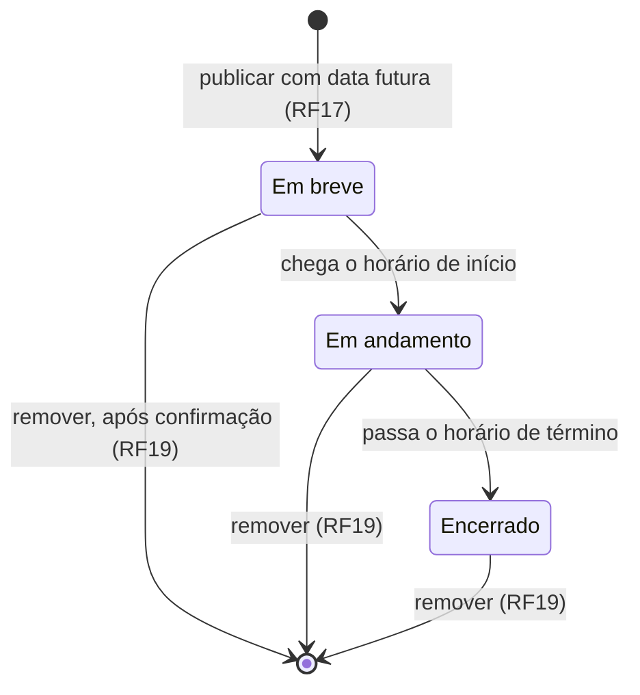
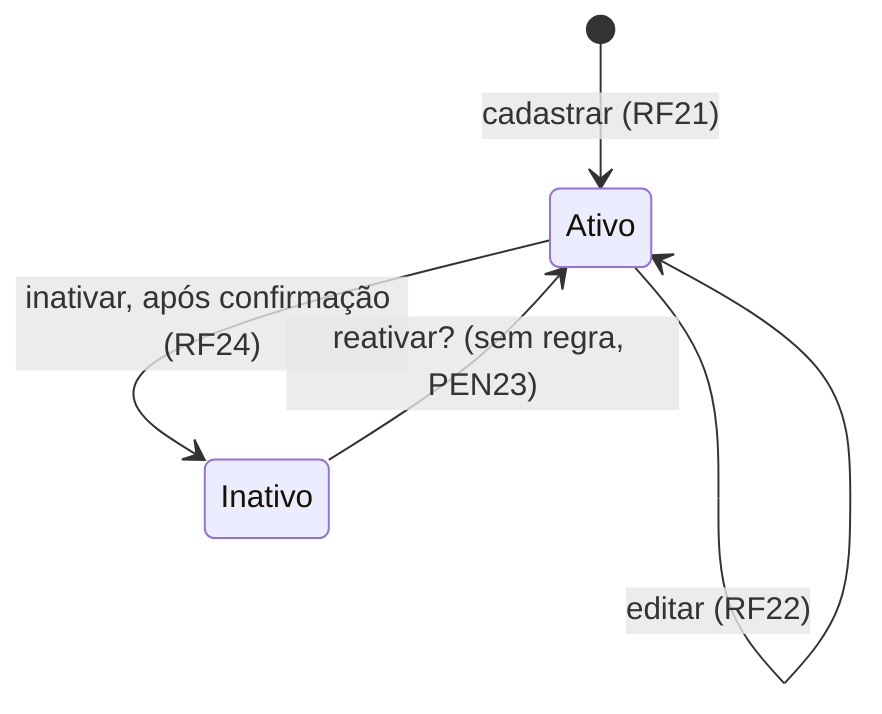
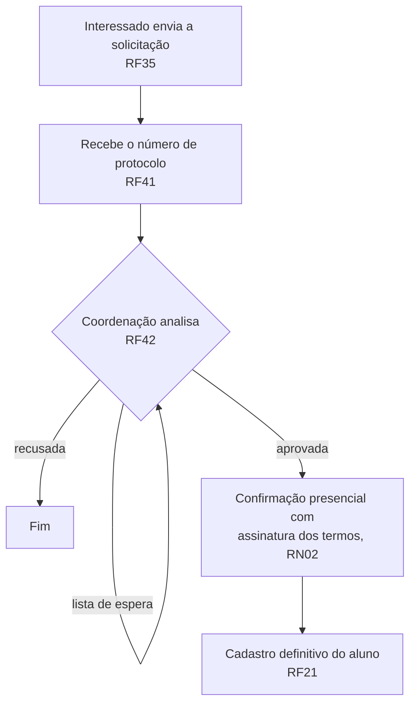

# 5 ENGENHARIA DE REQUISITOS

## 5.1 Atividades e Técnicas de ER

**Elicitação e Descoberta:**

- **Entrevista com Stakeholders:** Reuniões com a equipe de coordenação do CECP para reconhecer e compreender os maiores desafios dentro do fluxo atual de operação, ouvir suas necessidades, desejos e expectativas e identificar o caráter do problema.
    - **Status:** realizada continuamente
    - **Evidências:** atas das reuniões com o cliente: [17/09](https://mdsreq-fga-unb.github.io/REQ-2026.2-T01-SigCecp/historico/organizacao_e_planejamento/atas_reunioes/cliente/ata_reuniao_17_09/), [22/09](https://mdsreq-fga-unb.github.io/REQ-2026.2-T01-SigCecp/historico/organizacao_e_planejamento/atas_reunioes/cliente/ata_reuniao_22_09/), [24/09](https://mdsreq-fga-unb.github.io/REQ-2026.2-T01-SigCecp/historico/organizacao_e_planejamento/atas_reunioes/cliente/ata_reuniao_24_09/), [26/09](https://mdsreq-fga-unb.github.io/REQ-2026.2-T01-SigCecp/historico/organizacao_e_planejamento/atas_reunioes/cliente/ata_reuniao_26_09/), [08/10](https://mdsreq-fga-unb.github.io/REQ-2026.2-T01-SigCecp/historico/organizacao_e_planejamento/atas_reunioes/cliente/ata_reuniao_09_10/), [21/10](https://mdsreq-fga-unb.github.io/REQ-2026.2-T01-SigCecp/historico/organizacao_e_planejamento/atas_reunioes/cliente/ata_reuniao_21_10/), [30/10](https://mdsreq-fga-unb.github.io/REQ-2026.2-T01-SigCecp/historico/organizacao_e_planejamento/atas_reunioes/cliente/ata_reuniao_30_10/), [10/11](https://mdsreq-fga-unb.github.io/REQ-2026.2-T01-SigCecp/historico/organizacao_e_planejamento/atas_reunioes/cliente/ata_reuniao_10_11/). Gravações: [17/09](https://mdsreq-fga-unb.github.io/REQ-2026.2-T01-SigCecp/historico/gravacoes/reunioes_cliente/reuniao_audio_17_09/), [22/09](https://mdsreq-fga-unb.github.io/REQ-2026.2-T01-SigCecp/historico/gravacoes/reunioes_cliente/reuniao_audio_22_09/), [24/09](https://mdsreq-fga-unb.github.io/REQ-2026.2-T01-SigCecp/historico/gravacoes/reunioes_cliente/reuniao_audio_24_09/), [26/09](https://mdsreq-fga-unb.github.io/REQ-2026.2-T01-SigCecp/historico/gravacoes/reunioes_cliente/reuniao_audio_26_09/), [08/10](https://mdsreq-fga-unb.github.io/REQ-2026.2-T01-SigCecp/historico/gravacoes/reunioes_cliente/reuniao_audio_09_10/), [21/10](https://mdsreq-fga-unb.github.io/REQ-2026.2-T01-SigCecp/historico/gravacoes/reunioes_cliente/reuniao_audio_21_10/), [30/10](https://mdsreq-fga-unb.github.io/REQ-2026.2-T01-SigCecp/historico/gravacoes/reunioes_cliente/reuniao_video_30_10/). 

- **Brainstorming dos desenvolvedores:** Discussões entre os desenvolvedores serviram para elencar os desafios e sugerir soluções que transformassem o atual fluxo manual em um processo digital. A técnica foi aplicada de forma contínua e informal, sem sessões formais de brainstorming: as ideias eram acatadas ou descartadas ao longo do trabalho, servindo tanto à elicitação quanto ao refinamento dos requisitos.
    - **Status:** realizada continuamente, informalmente
    - **Evidências:** Sem registros formais, e houve uma Reunião não gravada entre os desenvolvedores em 24/10 em que foram tratados o Brainstorming dos Desenvolvedores e uma breve Revisão por Pares dos novos requisitos elicitados em tal reunião.

**Análise e Consenso:**

- **Priorização de Requisitos (Matriz de Avaliação Técnica x Valor de Negócio):** Técnica utilizada entre equipe e cliente para classificar as funcionalidades levantadas cruzando dois eixos: complexidade/esforço técnico de implementação e valor gerado para o negócio. Permite identificar quais funcionalidades entregam mais valor com menor esforço, chegando a um consenso sobre o núcleo essencial do sistema (a definição do MVP), reduzindo escopo e resolvendo conflitos sobre o que é prioritário para entrega.
    - **Status:** realizada; matriz final validada com o cliente em 30/10/2026
    - **Evidências:** [Evidências da priorização](https://mdsreq-fga-unb.github.io/REQ-2026.2-T01-SigCecp/historico/priorizacao_geral_e_mvp/), [Backlog e MVP](https://mdsreq-fga-unb.github.io/REQ-2026.2-T01-SigCecp/historico/10_backlog_produto/), confirmação do MVP de 18 RFs na [ata de 30/10](https://mdsreq-fga-unb.github.io/REQ-2026.2-T01-SigCecp/historico/organizacao_e_planejamento/atas_reunioes/cliente/ata_reuniao_30_10/) ([DEC03](../../painel.md#DEC03))
    - **Ressalva:** a posição de esforço de 30 RFs na matriz final não coincide com o arredondamento da média dos votos. A equipe reavaliou essas posições ao montar a matriz em 30/10, e a coluna "Esforço na matriz" da priorização é a vigente; no empate da moda, vale o maior valor ([priorização](../../historico/priorizacao_geral_e_mvp.md), seção 5)

- **MoSCoW:** Técnica de priorização utilizada para classificar os requisitos de acordo com seu grau de importância para o sistema. Os requisitos são divididos em quatro categorias: **Must have, Should have, Could have e Won’t have.** A técnica auxilia a equipe e o cliente a estabelecer prioridades claras, controlar o escopo e garantir que os recursos disponíveis sejam direcionados inicialmente às funcionalidades mais essenciais.
    - **Status:** realizada em 24/09, refeita em 08/10 e confirmada em 30/10/2026
    - **Evidências:** [ata de 24/09](https://mdsreq-fga-unb.github.io/REQ-2026.2-T01-SigCecp/historico/organizacao_e_planejamento/atas_reunioes/cliente/ata_reuniao_24_09/) (primeira classificação), [ata de 08/10](https://mdsreq-fga-unb.github.io/REQ-2026.2-T01-SigCecp/historico/organizacao_e_planejamento/atas_reunioes/cliente/ata_reuniao_09_10/) (reclassificação) e [ata de 30/10](https://mdsreq-fga-unb.github.io/REQ-2026.2-T01-SigCecp/historico/organizacao_e_planejamento/atas_reunioes/cliente/ata_reuniao_30_10/) (validação do conjunto final, [DEC03](../../painel.md#DEC03))

**Declaração de Requisitos:**

- **Declaração Estruturada de Requisitos:** Técnica de declaração utilizada para especificar os requisitos descobertos em fichas para cada requisito, contendo identificador único, descrição, classificação como Requisito Funcional (RF) ou Requisito Não Funcional (RNF), Regras de Negócio (RN), Característica de Produto (CP) de origem, ator, entradas, pré-condições, processamento, saídas, critério de aceitação e andamento, a fim de garantir rastreabilidade, testabilidade e comunicação clara entre equipe e cliente. Todos os requisitos podem ser facilmente acessados pelo Painel do Escopo.
    - **Status:** realizada continuamente
    - **Evidências:** [Painel do Escopo](https://mdsreq-fga-unb.github.io/REQ-2026.2-T01-SigCecp/painel/) em modais com acesso às fichas, exemplo de ficha: [RF00](https://mdsreq-fga-unb.github.io/REQ-2026.2-T01-SigCecp/visao/escopo/requisitos/RF00/).

**Representação de Requisitos:**

Representar não é só desenhar telas: é tornar visível qualquer estrutura, comportamento ou relação que ajude a entender o sistema. O projeto usa representações informais e semiformais, escolhidas pelo foco que cada uma privilegia. Não há representação formal: nenhum requisito tem criticidade alta, lógica complexa ou ambiguidade persistente que justifique formalizar.

- **Representações contextuais (informais):** Rich Picture do fluxo atual, diagrama de Ishikawa das causas do problema e mapa de stakeholders. Definem o escopo e as interações com o ambiente.
    - **Status:** realizada
    - **Evidências:** [seção 1.3](1_cenario_atual.md#13-rich-picture), [seção 1.4](1_cenario_atual.md#14-identificacao-da-oportunidade-ou-problema), [seção 1.6](1_cenario_atual.md#16-mapa-de-stakeholders)

- **Protótipos (experienciais, informais):** telas navegáveis no Figma, usadas para validar com o cliente fluxos, campos e regras de cada requisito, e não apenas a aparência. A identidade visual (cores e logo) é uma decisão de design e fica fora do núcleo da representação de requisitos.
    - **Status:** realizada para todo o MVP: CP3 (RF13 a RF20) em 30/10 e acesso, turmas, alunos e coordenadores em 10/11/2026
    - **Evidências:** [Design do usuário](https://mdsreq-fga-unb.github.io/REQ-2026.2-T01-SigCecp/historico/designUser_iteracao5/) (protótipo no Figma e PDF por requisito), [ata de 10/11](https://mdsreq-fga-unb.github.io/REQ-2026.2-T01-SigCecp/historico/organizacao_e_planejamento/atas_reunioes/cliente/ata_reuniao_10_11/)

- **Diagramas de estados e de fluxo (comportamentais, semiformais):** representam o ciclo de vida do evento e do aluno e o fluxo da matrícula online, que o texto das fichas descreve de forma espalhada. Ao desenhar o ciclo do aluno, a equipe descobriu uma lacuna: não há regra para reativar um aluno inativo ([PEN23](../../painel.md#PEN23)).
    - **Status:** realizada em 14/11/2026
    - **Evidências:** [seção 5.3](#53-representacoes-comportamentais)

- **Rastreabilidade visual (semiformal):** o grafo de rastreabilidade (problema → objetivos → características → RFs) e os vínculos navegáveis do painel do escopo (RF ↔ RN, RNF, decisões e pendências).
    - **Status:** realizada
    - **Evidências:** [matriz-síntese e grafo de rastreabilidade](8_rastreabilidade.md), [Painel do Escopo](https://mdsreq-fga-unb.github.io/REQ-2026.2-T01-SigCecp/painel/)

**Verificação e Validação de Requisitos:**

- **Revisão por pares (Verificação):** Os requisitos descobertos serão revisados internamente entre os desenvolvedores antes da apresentação ao cliente, examinando consistência, completude e testabilidade.
    - **Status:** realizada informalmente.
    - **Evidências:** Sem registros formais, e houve uma Reunião não gravada entre os desenvolvedores em 24/10 em que foram tratados o Brainstorming dos Desenvolvedores e uma breve Revisão por Pares dos novos requisitos elicitados em tal reunião.

- **Análise de consistência e de rastreabilidade (Verificação):** confronta as fontes do escopo entre si (fichas, regras, RNFs, decisões, backlog e cronograma). Parte é automática: a cada build, o gerador do painel aponta regra de negócio inexistente, RF do MVP fora do cronograma, RF pós-MVP agendado e decisão sem data ou fonte (aba *Alertas*). Em 14/11/2026 foi feita uma análise cruzada completa, que corrigiu vínculos RF ↔ RNF e RF ↔ RN só de um lado, versões desencontradas e RFs retirados ainda listados.
    - **Status:** realizada continuamente (alertas) e em 14/11/2026 (análise completa)
    - **Evidências:** aba *Alertas* do [Painel do Escopo](https://mdsreq-fga-unb.github.io/REQ-2026.2-T01-SigCecp/painel/); histórico de mudanças das fichas e dos RNFs

- **Checklists e critérios de qualidade (Verificação):** o DoR funciona como checklist de prontidão de cada requisito, e os critérios de qualidade da [seção 5.4](#54-criterios-de-qualidade-usados-na-verificacao) transformam adjetivos ("claro", "completo") em perguntas com evidência observável.
    - **Status:** realizada para RF13 a RF20 (DoR registrado)
    - **Evidências:** [DoR e DoD, seção 9.3](9_dor_e_dod.md#93-aplicacao-registrada)

- **Revisão de Requisitos com Stakeholders (Validação):** Os requisitos especificados serão apresentados ao representante e à equipe do CECP para confirmar se refletem corretamente as necessidades identificadas, podendo ser aprovados, rejeitados ou ajustados conforme o entendimento dos stakeholders. Essa técnica pode ser aplicada sempre que houver necessidade de revisar requisitos, especialmente antes da existência de protótipos que permitam uma validação mais visual.
    - **Status:** realizada
    - **Evidências:** [Detalhamento dos Requisitos](https://mdsreq-fga-unb.github.io/REQ-2026.2-T01-SigCecp/historico/organizacao_e_planejamento/atas_reunioes/cliente/ata_reuniao_21_10/) e atas das reuniões com o cliente (ver Entrevista com Stakeholders) 

- **Sessão de Validação com Protótipo (Validação):** A validação dos requisitos ocorrerá por meio da apresentação dos protótipos ao representante e à equipe do CECP, que poderão aprovar, rejeitar ou sugerir ajustes para que os requisitos alcancem o resultado esperado.
    - **Status:** realizada para CP3 em 30/10/2026 e para as demais telas do MVP em 10/11/2026. O retorno das demais pessoas do CECP também foi positivo. Em 10/11 o cliente também usou o sistema construído de CP3 e de acesso e o aceitou
    - **Evidências:** [Design do Usuário](https://mdsreq-fga-unb.github.io/REQ-2026.2-T01-SigCecp/historico/designUser_iteracao5/), [ata de 10/11](https://mdsreq-fga-unb.github.io/REQ-2026.2-T01-SigCecp/historico/organizacao_e_planejamento/atas_reunioes/cliente/ata_reuniao_10_11/)

**Organização e Atualização de Requisitos:**

- **Gestão do escopo de requisitos:** mantém o escopo estruturado e coerente com o entendimento vigente. Cada requisito tem identificador único e uma ficha que preserva suas relações: característica e objetivo de origem, regras de negócio, RNFs, critérios de aceitação, decisões, andamento com evidência e histórico de mudanças. O [Painel do Escopo](https://mdsreq-fga-unb.github.io/REQ-2026.2-T01-SigCecp/painel/) oferece visões diferentes do mesmo escopo (por característica, estado, entrega e pendência), e as issues do GitHub acompanham a construção.
    - **Escopos distintos:** escopo do produto ([seção 2](2_solucao_proposta.md)); escopo de requisitos (painel e fichas); escopo da entrega, o MVP de 18 RFs ([DEC03](../../painel.md#DEC03), com a ordem de construção no [backlog](https://mdsreq-fga-unb.github.io/REQ-2026.2-T01-SigCecp/historico/10_backlog_produto/)); e escopo do projeto, o [cronograma](../../cronograma/6_cronograma.md), que inclui trabalho fora do escopo de requisitos, como capacitação e cadastro inicial dos dados ([DEC32](../../painel.md#DEC32)).
    - **Atualização:** cada mudança é registrada como decisão e propagada a tudo o que ela afeta. Exemplo: a [DEC27](../../painel.md#DEC27) (subtítulo opcional) alterou as fichas do RF17 e do RF18, o backlog e o registro do DoR. O que deixa de valer vai para o histórico das fichas ou para os [documentos arquivados](https://mdsreq-fga-unb.github.io/REQ-2026.2-T01-SigCecp/historico/arquivo/), sem apagar a memória.
    - **Calibragem:** estrutura intermediária (visões, versões, histórico seletivo e decisões registradas), proporcional a um projeto de baixa criticidade com uma única equipe. A rastreabilidade é a suficiente para responder de onde veio cada requisito, o que o condiciona e como é avaliado.
    - **Status:** realizada continuamente.
    - **Evidências:** [Painel do Escopo](https://mdsreq-fga-unb.github.io/REQ-2026.2-T01-SigCecp/painel/), [decisões e pendências](../escopo/decisoes.md), [GitHub Projects](https://github.com/orgs/mdsreq-fga-unb/projects/118/views/1) (o quadro precisa ser atualizado, issue #25), [Backlog e MVP](https://mdsreq-fga-unb.github.io/REQ-2026.2-T01-SigCecp/historico/10_backlog_produto/) e o [Painel do Escopo](https://mdsreq-fga-unb.github.io/REQ-2026.2-T01-SigCecp/painel/).

## 5.2 Engenharia de Requisitos e o RAD

| Fases do RAD | Atividades de ER | Prática Técnica | Resultado Esperado |
|---|---|---|---|
| **Planejamento de Requisitos** | Elicitação e Descoberta — Identificação de necessidades e contexto | Entrevista com stakeholders e brainstorming dos desenvolvedores | Necessidades, dificuldades e requisitos de alto nível\* identificados |
| | Análise e Consenso — Definição de prioridades e escopo acordado | Priorização de Requisitos (Matriz de Avaliação Técnica x Valor de Negócio) | Funcionalidades essenciais priorizadas e acordadas |
| | Declaração — Comunicação estruturada dos requisitos | Declaração Estruturada de Requisitos | Requisitos identificados, classificados e numerados |
| | Verificação e Validação — Verificação de qualidade interna e validação com stakeholders | Revisão por Pares (Verificação) e Revisão de Requisitos com Stakeholders (Validação) | Requisitos verificados quanto à consistência interna e confirmados como representativos das necessidades reais do CECP |
| | Organização e Atualização — Estruturação inicial dos requisitos | Gestão de Backlog de Requisitos (via GitHub Projects e Painel do Escopo) | Requisitos organizados e acompanhados por meio de issues e de fichas |
| **Design do Usuário** | Representação — Telas, fluxos e estados | Protótipos e diagramas de estados e de fluxo | Telas, fluxos e ciclos de vida representados para avaliação com os stakeholders |
| | Verificação e Validação — Verificação de qualidade interna e validação com stakeholders | Análise de consistência entre fichas e protótipos, Revisão por Pares (Verificação) e Sessão de Validação com Protótipo (Validação) | Protótipos coerentes com as regras e com os fluxos de uso esperados |
| | Elicitação e Descoberta — Refinamento dos requisitos | Entrevista com stakeholders | Novos requisitos ou ajustes detalhados a partir da interação visual do cliente com os protótipos |
| | Análise e Consenso — Revisão de prioridades a partir do protótipo | Priorização de Requisitos (Matriz de Avaliação Técnica x Valor de Negócio) | Prioridades revisadas e reacordadas conforme aprendizado obtido com os protótipos |
| | Declaração — Consolidação dos esclarecimentos | Declaração Estruturada de Requisitos | Detalhes acordados incorporados às declarações dos requisitos correspondentes |
| | Organização e Atualização — Registro das avaliações | Gestão de Backlog de Requisitos (Painel do Escopo e GitHub Projects) | Avaliações do cliente e protótipos vinculados às issues dos requisitos já definidos |
| **Construção** | Organização e Atualização — Manutenção dos requisitos | Gestão de Backlog de Requisitos (Painel do Escopo e GitHub Projects) | Requisitos e mudanças mantidos em estado atual |
| | Verificação e Validação — Verificação dos requisitos alterados | Revisão por Pares (Verificação) | Requisitos modificados verificados quanto à qualidade interna |
| | Elicitação, Análise, Declaração e Representação — Ajuste de requisitos emergentes | Entrevista com stakeholders, Priorização de Requisitos (Matriz de Avaliação Técnica x Valor de Negócio), Declaração Estruturada de Requisitos e Protótipos e Wireframes | Novos requisitos ou ajustes identificados durante a construção devidamente elicitados, analisados, declarados e representados |
| **Transição** | Verificação e Validação — Validação final dos requisitos | Sessão de Validação com Protótipo (Validação) | Confirmação de que os requisitos atendidos correspondem às necessidades do CECP |
| | Organização e Atualização — Consolidação dos requisitos | Gestão de Backlog de Requisitos (Painel do Escopo e GitHub Projects) | Estado final dos requisitos e itens futuros devidamente registrados |

> \*Requisitos de alto nível referem-se a requisitos amplos e ainda pouco detalhados, identificados na fase inicial de elicitação, antes do refinamento realizado nas etapas de Análise e Declaração.

## 5.3 Representações comportamentais

Os diagramas abaixo representam comportamentos que as fichas descrevem em texto. Eles não criam regras novas: cada transição aponta para a regra ou decisão de origem.

### Ciclo de vida do evento (RF17 a RF20)

O estado é calculado pela data e pelo horário do evento ([RN33](../../painel.md#RN33)). Editar a data (RF18) recalcula o estado, como foi demonstrado na reunião de 10/11. A remoção é definitiva ([DEC08](../../painel.md#DEC08)).

### Ciclo de vida do aluno (RF21 a RF25)

O aluno nunca é excluído, só inativado ([RN01](../../painel.md#RN01)). A inativação é manual e pede confirmação ([RN47](../../painel.md#RN47), [RN48](../../painel.md#RN48)). A remoção de dados (RF25, pós-MVP) apaga os documentos de identificação, mas mantém o aluno e seu histórico. Não há regra para voltar de inativo para ativo ([PEN23](../../painel.md#PEN23)).

### Fluxo da matrícula online (RF35, RF41, RF42; pós-MVP)

A solicitação online é uma pré-matrícula: a aprovada só vira cadastro depois da confirmação presencial ([DEC18](../../painel.md#DEC18), [RN02](../../painel.md#RN02)). O que a aprovação reserva (vaga, prazo, documentos) ainda está em aberto ([PEN12](../../painel.md#PEN12)).

## 5.4 Critérios de qualidade usados na verificação

Dizer que um requisito "deve ser claro" não basta. Cada critério abaixo vira uma pergunta e uma evidência observável no projeto.

| Critério | Pergunta de verificação | Como é verificado no SigCECP |
| :--- | :--- | :--- |
| Clareza | O cliente entende o requisito sem tradução? | Fichas e protótipos apresentados ao cliente e aprovados (atas de 30/10 e 10/11); dúvidas viram pendências no painel |
| Ausência de ambiguidade | Os termos têm leitura única? | Termos com valores observáveis, como os estados do evento (RN33), 8 minutos (RNF01), 2 segundos (RNF03) e até 10 sessões (DEC29) |
| Completude suficiente | Faltam atores, regras ou exceções? | O painel conta campos "(a detalhar)" e marcas [PENDENTE]; o DoR exige ficha sem essas marcas; lacunas viram pendências |
| Consistência | O requisito conflita com regras, decisões ou representações? | Alertas automáticos do painel, análise cruzada das fontes e confronto com os diagramas da seção 5.3 |
| Verificabilidade | É possível demonstrar o atendimento? | Critérios de aceitação em Dado/Quando/Então, executados com o cliente (ata de 10/11); RNFs com métrica e método de medição |
| Rastreabilidade e pertinência | Qual a origem e o valor do requisito? | Cada ficha liga o RF à característica e ao objetivo de origem, ao valor de negócio (MoSCoW), às decisões e às evidências de andamento |

**Calibragem:** o rigor segue o risco. Os requisitos do MVP próximos da construção recebem V&V moderada (DoR, critérios de aceitação e teste com o cliente). Os requisitos pós-MVP, ainda em rascunho, recebem V&V leve, com as dúvidas registradas como pendências até o detalhamento.

## Versionamento

| Versão | Data | Descrição | Autor(es/as) | Revisor(es/as) |
| :--- | :--- | :--- | :--- | :--- |
| 1.0 | 05/09/2026 | Transcrição do documento para markdown | [Marcos Monteiro](https://github.com/montmarcos) |  |
| 1.1 | 19/09/2026 | Revisão das técnicas de Engenharia de Requisitos com base em feedback recebido durante o desenvolvimento do projeto | Ana Paula Jardim | Marcos Monteiro |
| 1.2 | 13/11/2026 | Inclusão de status e evidências por técnica de ER; atualização da descrição da Declaração Estruturada de Requisitos e Organização e Atualização | Ana Paula Jardim |  |
| 1.3 | 14/11/2026 | Issue #26: MoSCoW e priorização com as três reuniões e a confirmação do MVP em 30/10 (DEC03); ressalva sobre a reconciliação do esforço (PEN06); status de prototipação e validação com protótipo atualizados para CP3 | — |  |
<<<<<<< HEAD
| 1.4 | 14/11/2026 | Evidências da reunião de 10/11/2026 (protótipo das demais telas do MVP e aceite de CP3 e do acesso) e alinhamento às aulas dos capítulos 10 a 12: representação além das telas (contextuais, protótipos, diagramas comportamentais e rastreabilidade), sem atribuir aos protótipos a identidade visual; novas técnicas de verificação (análise de consistência e rastreabilidade, checklists e critérios de qualidade); organização e atualização descritas por escopos, propagação de mudanças e calibragem; novas seções 5.3 (diagramas de estados e de fluxo) e 5.4 (critérios de qualidade) | Marcos Monteiro | Ana Paula Jardim |

=======
| 1.4 | 14/11/2026 | Evidências da reunião de 10/11/2026 (protótipo das demais telas do MVP e aceite de CP3 e do acesso) | — |  |
| 1.5 | 14/11/2026 | Alinhamento às aulas dos capítulos 10 a 12: representação além das telas (contextuais, protótipos, diagramas comportamentais e rastreabilidade), sem atribuir aos protótipos a identidade visual; novas técnicas de verificação (análise de consistência e rastreabilidade, checklists e critérios de qualidade); organização e atualização descritas por escopos, propagação de mudanças e calibragem; novas seções 5.3 (diagramas de estados e de fluxo) e 5.4 (critérios de qualidade) | — |  |
| 1.6 | 15/11/2026 | A evidência da rastreabilidade visual passa a apontar para a página vigente de [Rastreabilidade](8_rastreabilidade.md), e não para o documento arquivado | — |  |
>>>>>>> aebb0eb (Ajustes issue 33)
